# Garage Suite Software Requirements Specification

**Garage Management ERP on Odoo 19**  
**Editions:** Garage Suite Basic and Garage Suite Pro

| Document control | Value |
| --- | --- |
| Document identifier | GS-SRS-001 |
| Version | 1.0 |
| Revision date | 9 November 2026 |
| Status | Draft for stakeholder review |
| Intended readers | Product owners, garage operations teams, architects, developers, testers and implementation teams |
| Approval authority | Product owner and nominated business stakeholders |
| Approval date | Pending |

This document specifies the proposed behavior, business controls and acceptance conditions for Garage Suite. Basic provides a complete workshop servicing application. Pro extends the same records and codebase with parts trading, procurement, advanced inventory, accounting, branches and mobile experiences. The specification is the baseline for scope review, design and acceptance testing; it does not assert that the described features are already implemented.

## Contents

1. [Purpose and scope](#1-purpose-and-scope)
2. [Users and responsibilities](#2-users-and-responsibilities)
3. [Functional requirements](#3-functional-requirements)
4. [Detailed workflow charts](#4-detailed-workflow-charts)
5. [State transitions and business rules](#5-state-transitions-and-business-rules)
6. [Data requirements and architecture](#6-data-requirements-and-architecture)
7. [Interfaces and integration requirements](#7-interfaces-and-integration-requirements)
8. [Nonfunctional requirements](#8-nonfunctional-requirements)
9. [Acceptance and traceability](#9-acceptance-and-traceability)
10. [Delivery and approval decisions](#10-delivery-and-approval-decisions)
11. [Glossary](#11-glossary)
12. [Appendix A Feature catalogue and design proposals](#appendix-a-feature-catalogue-and-design-proposals)

## 1 Purpose and scope

### 1.1 Purpose

Garage Suite shall manage the service lifecycle from appointment or walk-in reception to inspection, estimate approval, workshop execution, quality control, billing, delivery and subsequent reminders. Each service visit shall be traceable through a job card linked to the customer, vehicle, approved work, materials, labour and financial documents.

The intended businesses include independent garages, motorcycle service centres, multi-brand workshops, parts retailers and wholesalers, fleet maintenance providers and workshop chains.

### 1.2 Edition boundaries

| Capability group | Basic | Pro |
| --- | --- | --- |
| Customers, vehicles and service history | Included | Included |
| Appointments, job cards, inspections and technician work | Included | Included with advanced resource planning |
| Estimates, consent, service invoicing and payment tracking | Included | Included with integrated accounting |
| Parts consumption on service jobs | Included | Included with advanced inventory |
| Simple workshop stock balances | Optional module | Included |
| Parts trading, purchasing, warehouses and POS | Excluded | Included |
| Full ledger, valuation, reconciliation and financial statements | Excluded from product scope | Included subject to selected accounting dependencies |
| Reminders and operational reports | Included | Included with advanced CRM and analytics |
| Multi-branch, multi-company and enterprise contracts | Excluded | Included |
| Customer, technician and management mobile apps | Excluded | Included |
| WhatsApp | Optional | Included subject to provider configuration |
| Customer portal and mobile estimate approval | Optional | Included |
| AI assistance | Excluded | Optional future modules |

Basic shall remain a usable standalone product. Pro shall install additional capabilities without duplicating or migrating core customer, vehicle and job-card records into different models. Technical dependencies needed for Basic invoicing do not automatically expose the full Pro accounting feature set.

### 1.3 Requirement conventions

- **Shall** denotes a mandatory requirement within the selected edition or enabled optional module.
- **Should** denotes a recommendation subject to design review.
- **May** denotes an optional capability.
- Requirement IDs remain stable when wording is revised. `FR` identifies functional requirements, `BR` business rules, `NFR` quality requirements, `INT` interfaces and `AT` acceptance scenarios.
- Appendix A retains the detailed feature catalogue and planning proposals. Core requirements and workflow controls below take precedence where the catalogue describes only a simplified happy path.
- Performance numbers, recovery objectives, commercial terms and external providers require explicit approval before they become release commitments.

### 1.4 Assumptions and dependencies

The product uses Odoo 19 and PostgreSQL. Standard Odoo entities should be reused where their installed applications provide the required behavior. The Community or Enterprise foundation, accounting implementation and distribution obligations remain architecture decisions. Optional gateways, catalogues and cloud services require provider credentials and supported integration contracts.

Tax features in the catalogue are scope requirements, not a determination of statutory applicability. Localization and statutory integrations require validation for the deployment jurisdiction before release.

## 2 Users and responsibilities

| Actor | Main responsibilities | Approval boundaries |
| --- | --- | --- |
| Receptionist | Register customers and vehicles; book appointments; record arrival | No financial or technical overrides by default |
| Service advisor | Capture complaints; prepare job cards and estimates; communicate with customers | Submit work for approval; retain consent evidence |
| Technician | Inspect assigned vehicles; record time, parts needs and repair evidence | Cannot approve customer estimates or release own failed QC |
| Quality inspector | Verify completed work, checklists and road tests | Pass jobs for readiness or return them for rework |
| Cashier | Generate authorized billing documents; collect and allocate payments | Discounts, refunds and credit follow delegated limits |
| Storekeeper | Reserve, issue, return and receive parts | Adjustments and substitutions require applicable approval |
| Purchase manager | Evaluate suppliers; approve purchase orders within limits | Pro purchasing role |
| Accountant and finance manager | Post and reconcile documents; manage credit and financial reports | Pro financial permissions and segregation of duties |
| Garage or branch manager | Allocate resources; approve exceptions; monitor delivery and performance | Scope limited to permitted branches and companies |
| Owner | Monitor business performance and delegated approvals | Access follows company and branch grants |
| Administrator | Configure users, modules, integrations and operational settings | Administrative access shall be assigned explicitly |
| Customer or fleet approver | Review own estimates; approve or reject; view authorized records | No access to other customers or unauthorized fleet vehicles |

Permissions shall be enforced on the server through access control lists, record rules and operation-specific checks. Menu visibility alone shall not grant or restrict data access.

## 3 Functional requirements

### 3.1 Basic workshop requirements

| ID | Requirement | Catalogue reference |
| --- | --- | --- |
| FR-B01 | The system shall maintain individual and corporate customer profiles, contacts, duplicate checks, outstanding balances and a consolidated customer view. | B01 |
| FR-B02 | The system shall maintain separate registration and VIN identifiers, vehicle specifications, ownership and odometer history, attachments and complete service history. | B02 |
| FR-B03 | The system shall support appointment booking, resource availability checks, confirmation, rescheduling, arrival, no-show and cancellation, plus walk-in reception. | B03 |
| FR-B04 | The system shall manage sequenced job cards linked to complaints, diagnosis, labour, technicians, parts, approvals, status history and delivery evidence. | B04 |
| FR-B05 | The system shall provide configurable reception, technical and final inspection checklists with results, remarks, photographs and required sign-offs. | B05 |
| FR-B06 | The system shall maintain service operations, labour codes, standard hours, rates, packages, discounts, tax configuration and planned versus actual labour. | B06 |
| FR-B07 | The system shall record parts quantities, consumption and returns against job cards. The optional stock module shall add receipts, issues, balances, adjustments and counts. | B07 |
| FR-B08 | The system shall generate versioned estimates with labour, parts, discounts, taxes and validity; record approval or rejection; and retain consent evidence. | B08 |
| FR-B09 | The system shall generate service invoices, track split and partial payments, outstanding balances, receipts, authorized credit notes and refunds. | B09 |
| FR-B10 | The system shall calculate service reminders, track follow-ups and feedback, and apply customer consent and channel preferences. | B10 |
| FR-B11 | The system shall provide workshop KPIs and operational reports with drill-down to authorized underlying transactions. | B11 |

### 3.2 Pro and mobile requirements

| ID | Requirement | Catalogue reference |
| --- | --- | --- |
| FR-P01 | The system shall maintain automotive part identities, OEM and aftermarket references, compatibility constraints, alternatives and price tiers. | P01 |
| FR-P02 | The system shall manage warehouses, locations, reservations, issues, returns, transfers, counts, traceable adjustments and configured valuation. | P02 |
| FR-P03 | The system shall manage suppliers, RFQs, comparisons, purchase approvals, partial receipts, returns and vendor-bill matching. | P03 |
| FR-P04 | The system shall support retail and wholesale quotations, orders, delivery, credit controls, returns and POS sessions with reconciliation. | P04 |
| FR-P05 | The system shall integrate receivables, payables, journals, bank reconciliation and financial statements with approved localization dependencies. | P05 |
| FR-P06 | The system shall plan bays and technicians using skills, workload, operation dependencies and availability, and report productivity separately from profitability. | P06 |
| FR-P07 | The system shall track accident assessment, surveyor approval, supplements, payer allocations, claims, settlement and outstanding amounts. | P07 |
| FR-P08 | The system shall check warranty, AMC and fleet entitlement, authorization limits, consumption, renewals and contract profitability. | P08 |
| FR-P09 | The system shall manage leads, campaigns, feedback, complaints, retention and configured loyalty benefits. | P09 |
| FR-P10 | The system shall support branch operations, consolidated permitted history, stock transfers and company isolation. | P10 |
| FR-P11 | The system shall provide operational, stock, financial and customer analytics with date, company, branch and relevant operational filters. | P11 |
| FR-P12 | Enabled extension modules shall provide HR integration, expenses, tools, pickup and delivery, documents, portals, communication, fleets, eCommerce, supplier access, audit and APIs. | P12–P24 |
| FR-P13 | Optional AI outputs shall remain advisory and require human verification before consequential operational actions. | P25 |
| FR-M01 | The customer app shall support authorized vehicles, booking, tracking, estimates, supplementary approvals, invoices, payment initiation and feedback. | M01 |
| FR-M02 | The technician app shall provide assigned jobs, inspection, timers, parts requests, evidence capture and completion submission, including the defined offline subset. | M02 |
| FR-M03 | The management app shall provide permitted dashboards, branch comparisons, alerts and delegated approvals. | M03 |
| FR-L01 | Edition upgrades shall preserve existing records and relationships; license expiry shall retain access to data and export under the agreed policy. | Catalogue A16–A17 |

## 4 Detailed workflow charts

Charts use Mermaid syntax. View this document in a Mermaid-capable Markdown viewer to render the diagrams. Arrows denote process progression, labelled decision branches denote conditions, and subgraphs identify responsibility. The charts specify proposed business behavior rather than existing implementation.

### 4.1 Appointment and vehicle reception

**Actors:** Customer, receptionist and service advisor. **Entry:** Booking request or walk-in. **Exit:** Job card created, rescheduled appointment, cancellation or no-show.

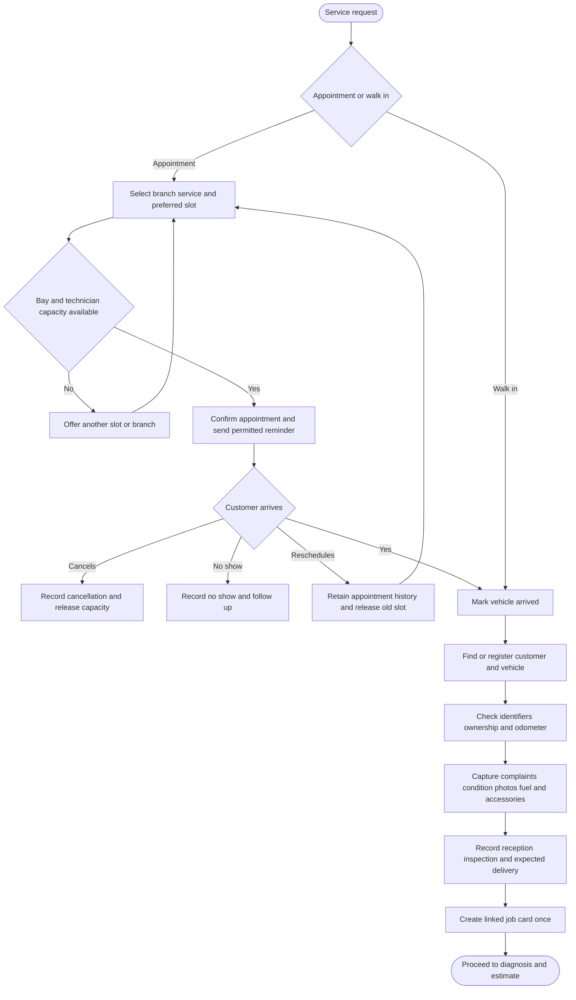

Conversion shall retain the appointment reference and shall not create a second job card when the same request is retried. No-show and cancelled appointments shall not be treated as completed service visits.

### 4.2 Service lifecycle with approval and quality gates

**Actors:** Service advisor, customer, technician, storekeeper, quality inspector and cashier. **Entry:** Open job card. **Exit:** Delivered and closed job, or recorded cancellation.

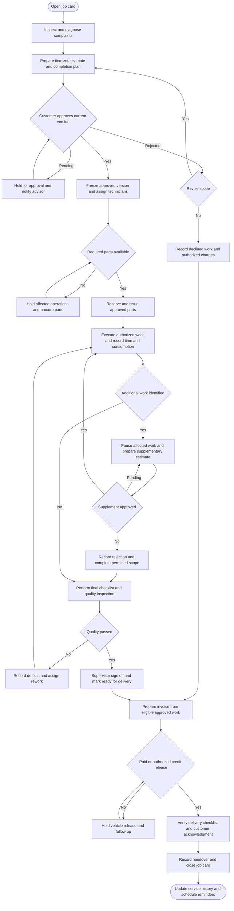

A rejected estimate ends the repair scope unless a revised version is approved. Any inspection or cancellation charge must itself be authorized. A declined job follows the applicable safe-return inspection and release checklist; it shall not be reported as a successfully completed repair.

### 4.3 Estimate versioning and customer consent

**Actors:** Advisor and customer or authorized fleet approver. **Entry:** Diagnosed or supplementary scope. **Exit:** Immutable approval evidence or rejection/expiry.

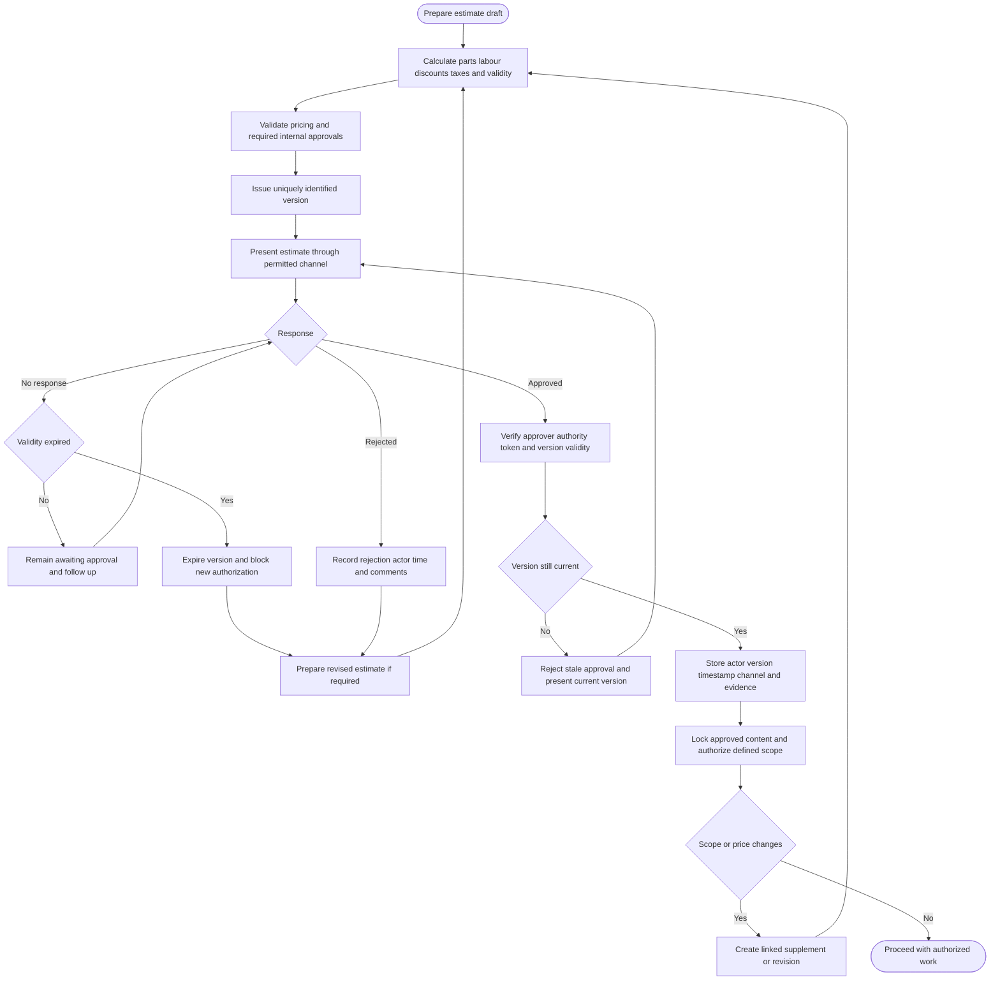

Manual consent shall include the staff recorder and supporting evidence. Customer rejection or timeout shall never be converted automatically into approval. Duplicate approval requests shall not create duplicate authorization records.

### 4.4 Parts reservation issue consumption and return

**Edition:** Pro, with a reduced transaction subset for the optional Basic stock module. **Entry:** Approved job requirement. **Exit:** Reconciled quantities and cost references.

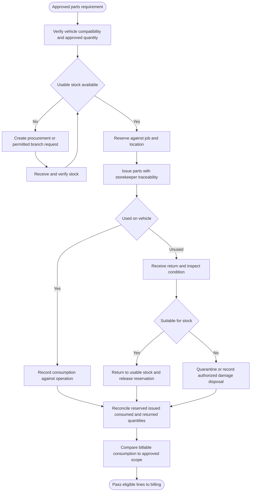

Reservation shall not be counted as physical issue or consumption. A substituted part requires compatibility verification and applicable approval, including fresh customer approval if scope or price changes.

### 4.5 Procurement receipt and supplier payment

**Edition:** Pro. **Actors:** Requester, purchasing, approving manager, storekeeper and finance.

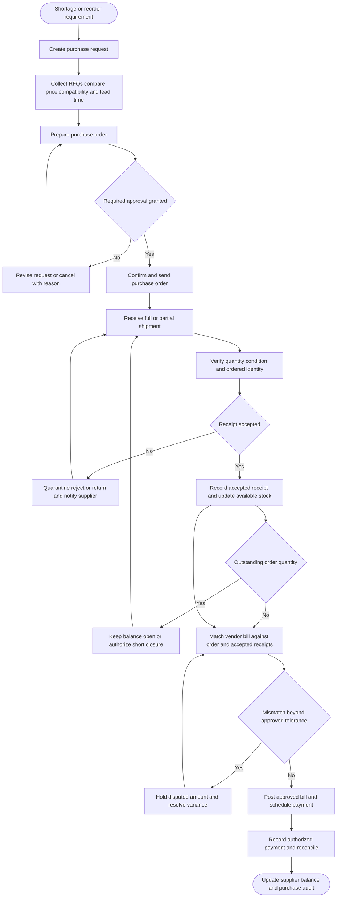

Partial receipts and eligible partial bills may proceed independently; they shall not imply full order completion. Short closure shall stop further expected receipts for the closed balance. A rejected or quarantined receipt shall not increase usable stock.

### 4.6 Billing payment credit and vehicle release

**Actors:** Advisor, cashier, finance approver and delivery staff. **Entry:** Ready job or authorized declined-service return. **Exit:** Controlled handover with traceable financial position.

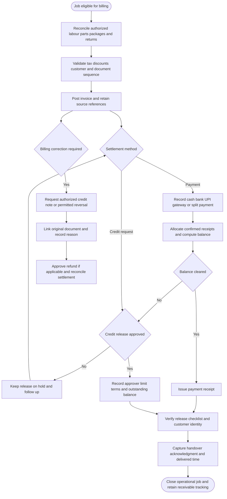

Payment initiation shall not count as receipt confirmation. A closed operational job may retain an approved receivable; collection tracking continues independently. Posted financial documents shall not be silently edited to correct charges.

### 4.7 Technician offline work and synchronization

**Edition:** Pro technician app. **Entry:** Authenticated user with permitted cached jobs. **Exit:** Server-validated updates or a visible conflict requiring resolution.

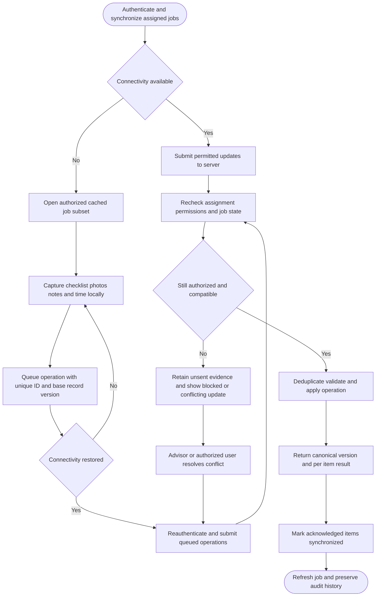

Offline capture shall not authorize customer consent, financial posting, stock posting or final vehicle release. Conflict resolution shall preserve evidence without exposing data after access has been revoked; retention and recovery rules require an approved mobile security design.

### 4.8 Inter branch stock transfer

**Edition:** Pro. **Entry:** Destination branch need. **Exit:** Reconciled receipt, discrepancy or cancelled request.

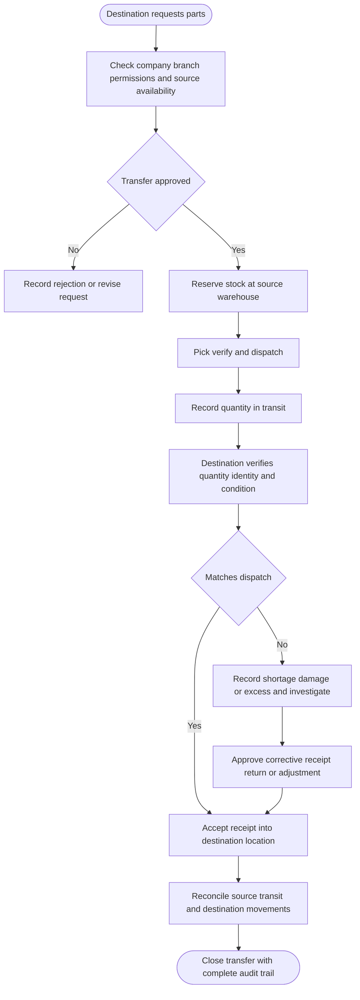

Cross-company supply shall use the approved intercompany commercial and accounting process; a branch transfer shall not bypass company isolation or create stock by changing a branch field.

### 4.9 Warranty AMC and insurance authorization

**Edition:** Pro; Basic warranty capability remains limited as defined in the catalogue.

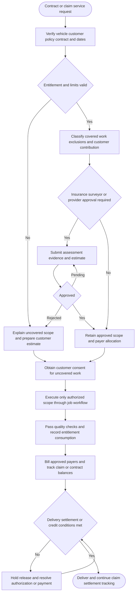

No entitlement or insurance approval shall substitute for consent to customer-pay work. Contract limits shall not be consumed twice by retries or reopened job processing.

### 4.10 Basic to Pro upgrade

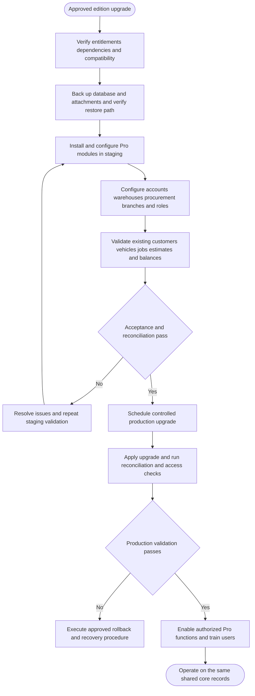

## 5 State transitions and business rules

### 5.1 Job state model

The following is the proposed canonical state model. Waiting reasons are recorded separately from the lifecycle state so a job does not lose its previous operational context.

| State | Entry condition | Permitted next states |
| --- | --- | --- |
| Draft | Reception details captured | Diagnosing, Cancelled |
| Diagnosing | Authorized inspection begins | Awaiting approval, Cancelled |
| Awaiting approval | Current estimate issued | Authorized, Diagnosing for revision, Cancelled |
| Authorized | Current scope approved | In progress, Awaiting approval for revised scope, Cancelled with reconciliation |
| In progress | Assigned technician starts authorized work | Quality check, On hold |
| On hold | Reason, responsible person and prior state recorded | Prior valid state after the blocking reason is resolved |
| Quality check | Required work and technician records complete | In progress for rework, Ready for delivery |
| Ready for delivery | Required quality checks and sign-off passed | Delivered after release gate, In progress through authorized rework |
| Delivered | Invoice and payment or credit gate satisfied; handover recorded | Closed |
| Closed | History and closure evidence complete | Authorized reopen through manager-controlled procedure |
| Cancelled | Cancellation authorized and parts, time and charges reconciled | No direct restart; create a linked follow-up job if required |

Customer-facing app statuses shall be mapped from these states. Cancellation is terminal for the visit but does not remove invoices, receivables, audit evidence or stock reconciliation obligations.

### 5.2 Mandatory controls

| ID | Business rule |
| --- | --- |
| BR-01 | An approved estimate shall retain an immutable version, approver, timestamp, channel and evidence. |
| BR-02 | Scope or price changes shall create a supplement or revision and require fresh approval before the affected work proceeds. |
| BR-03 | Mandatory checks and quality failures shall block readiness until resolved and signed off by an authorized user. |
| BR-04 | Vehicle release shall require confirmed settlement or an explicit authorized credit release and completed delivery checks. |
| BR-05 | Reserved, issued, consumed, returned and invoiced quantities shall remain distinguishable and reconcilable. |
| BR-06 | Company and branch restrictions shall apply consistently to UI, APIs, exports, reports, attachments and background operations. |
| BR-07 | Registration and VIN shall be distinct; duplicate checks, identifier changes, odometer anomalies and ownership transfers shall follow controlled procedures. |
| BR-08 | Posted invoice corrections, credits, refunds and cancellations shall retain the original document reference, reason and authorized actor. |
| BR-09 | Reopen, rework, cancellation, stock adjustment, discount and credit exceptions shall retain reason, actor and timestamp. |
| BR-10 | Reminder and marketing dispatch shall respect recorded consent and communication preferences. |
| BR-11 | Commercial license expiry shall preserve operational data access and export according to the approved grace-period and read-only policy. |
| BR-12 | Retried approvals, appointment conversion, stock operations, payments and synchronization shall not duplicate business effects. |
| BR-13 | Compatibility suggestions shall use verified catalogue information; substitutions and AI advice require the applicable human verification. |
| BR-14 | Multiple technicians and operations shall be supported without double counting labour time, stock consumption or package charges. |

## 6 Data requirements and architecture

### 6.1 Logical information model

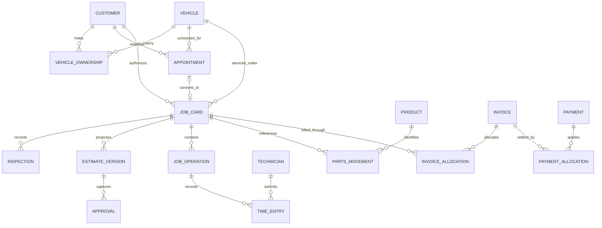

This logical model describes business relationships, not final Odoo table names. Allocation entities allow split payer billing, consolidated fleet billing and split payments without assuming a one-to-one invoice relationship. Vehicle ownership history shall retain prior owners and shall not expose their private records automatically to a new owner.

### 6.2 Data controls

- Job cards, estimates, invoices, claims and transfers shall have traceable identifiers; company and sequence policies shall be configured explicitly.
- Company, branch, customer, vehicle, currency, unit of measure and source-document references shall remain consistent across related transactions.
- Financial calculations shall use configured currency rounding, tax treatment and units of measure; package inclusions shall not be charged again as standalone lines.
- Attachments shall inherit applicable record access and be backed up with the database.
- Audit events shall record actor, timestamp, action, affected record and business reason where required. Authorized corrections shall preserve earlier evidence.
- Historical imports shall validate identifiers and reconcile opening balances before production use. Retention periods and deletion or anonymization rules require approval before release.

### 6.3 Module architecture

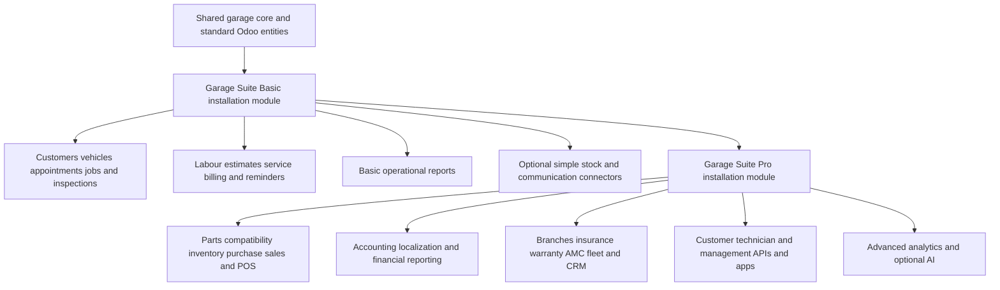

These arrows show capability composition, not exact manifest dependency direction. Appendix A12 contains proposed module names. Final manifests shall include the service-master dependency and a defined module owner for Basic parts consumption; these are not fully specified by the initial module list.

## 7 Interfaces and integration requirements

| ID | Interface | Required behavior |
| --- | --- | --- |
| INT-01 | Odoo web client | Role-based menus, searchable records, calendar and workshop views, clear validation and action feedback. |
| INT-02 | Customer portal and approval links | Verify record ownership or approver authority; use scoped, expiring credentials; reject revoked, expired and stale-version actions. |
| INT-03 | Mobile and external APIs | Authenticate requests; enforce server-side record permissions; validate payloads; return actionable errors and correlation references. |
| INT-04 | Payment gateways and bank imports | Verify provider authenticity, deduplicate notifications, distinguish initiation from settlement and reconcile fees or differences. |
| INT-05 | Email SMS WhatsApp and push | Apply consent, templates and permitted recipients; record delivery outcome; retry safely without duplicate notifications. |
| INT-06 | Accounting and statutory services | Use supported localization and configured mappings; retain request outcome and external reference; expose failed submissions for resolution. |
| INT-07 | Parts catalogues and barcode devices | Validate part identity and catalogue provenance; retain compatibility constraints; handle unknown scans without guessing. |
| INT-08 | Reports and exports | Apply record restrictions, filters, currency and date context; reconcile totals to their underlying records. |

API schemas, authentication protocol, webhook contracts, retry policy, rate limits and provider selections shall be specified in the separate API and integration design before implementation acceptance.

## 8 Nonfunctional requirements

| ID | Quality requirement | Verification approach |
| --- | --- | --- |
| NFR-01 | Every protected operation shall enforce server-side authorization and company or branch isolation. | Positive and negative role tests across UI, APIs, exports and attachments. |
| NFR-02 | Authentication credentials and provider secrets shall be protected; production transport shall be encrypted. | Security configuration review and authentication failure tests. |
| NFR-03 | Concurrent edits and repeated requests shall not silently lose approval evidence or duplicate material business transactions. | Parallel update and retry scenarios. |
| NFR-04 | Backups shall cover database and attachments, with documented restoration and recovery checks. | Restore to an isolated environment and reconcile representative records. |
| NFR-05 | Response-time and concurrency targets shall be approved against a representative dataset and deployment profile. | Load test against the approved performance plan. Numerical targets pending. |
| NFR-06 | Scheduled tasks and integrations shall expose failures and support controlled retries with business traceability. | Simulated provider outage, retry and reconciliation tests. |
| NFR-07 | Core workshop tasks shall provide readable status, understandable validation and keyboard-accessible primary actions. | Reception, estimate, technician and cashier usability walkthroughs. |
| NFR-08 | Modules shall declare dependencies and separate models, views, security, data and tests. | Installation, upgrade and automated regression checks. |
| NFR-09 | Mobile offline storage shall be limited to approved data, protect cached information and show unsynchronized or failed updates. | Offline, session-expiry, access-revocation and conflict tests. |
| NFR-10 | Dashboard metrics shall define source documents, time basis, denominators and treatment of returns, taxes and cancellations. | Compare sampled metrics with transaction-level calculations. |
| NFR-11 | The deployment shall support the approved cloud or customer-hosted topology with repeatable configuration and recovery instructions. | Deployment and recovery rehearsal. |
| NFR-12 | Personal data handling, retention, audit access and export shall follow approved organizational policies. | Permission and retention-policy review. |

Availability targets, recovery time objective, recovery point objective, supported mobile OS versions, offline retention and attachment-size limits remain open decisions. They shall not be represented as agreed service levels until approved.

## 9 Acceptance and traceability

The following scenarios establish the core acceptance baseline. The test plan shall expand each catalogue module into positive, negative, boundary and permission cases. Passing these scenarios alone does not establish acceptance of every catalogue feature.

| Test ID | Scenario and expected result | Traceability |
| --- | --- | --- |
| AT-01 | Convert a confirmed appointment twice. Exactly one linked job card exists; a walk-in can create a job without an appointment. | FR-B03, FR-B04, BR-12, workflow 4.1 |
| AT-02 | Register a vehicle with a duplicate VIN, then attempt a controlled registration change. Duplicate checks apply and permitted changes retain identifier history. | FR-B02, BR-07 |
| AT-03 | Approve estimate version one, then change a price. The approved version remains unchanged and the revised scope requires new consent. | FR-B08, BR-01, BR-02, workflow 4.3 |
| AT-04 | Submit approval from an expired link or for a superseded version. The system rejects it without authorizing work. | FR-B08, INT-02 |
| AT-05 | Reject an estimate. Unapproved repair work cannot begin; any permitted inspection charge retains separate authorization. | FR-B04, FR-B08, workflow 4.2 |
| AT-06 | Reserve parts, issue them, consume a subset and return the remainder. Each quantity is distinguishable and stock and billing reconcile without counting reservations as consumption. | FR-B07, FR-P02, BR-05, workflow 4.4 |
| AT-07 | Receive part of a purchase order and a mismatched vendor bill. Only accepted quantities enter usable stock; the disputed bill amount remains blocked pending resolution. | FR-P03, workflow 4.5 |
| AT-08 | Fail a mandatory quality check. Ready-for-delivery is blocked; rework and subsequent inspection remain traceable. | FR-B05, BR-03, workflow 4.2 |
| AT-09 | Attempt release against an unpaid invoice. Release is blocked unless an authorized credit decision is recorded; collections remain open afterward. | FR-B09, BR-04, workflow 4.6 |
| AT-10 | Record split payments and resend a confirmed gateway notification. The balance is correct and no duplicate payment is created. | FR-B09, INT-04, BR-12 |
| AT-11 | Correct a posted invoice and approve a refund. The original document, credit or reversal and settlement trail remain linked. | FR-B09, BR-08 |
| AT-12 | Access another company or unauthorized branch through direct API, export and attachment requests. Each access is denied. | FR-P10, BR-06, NFR-01 |
| AT-13 | Capture offline work, then change the server job and resynchronize twice. Conflicts are visible; acknowledged updates apply once and evidence is preserved under the access policy. | FR-M02, BR-12, NFR-09, workflow 4.7 |
| AT-14 | Withdraw marketing consent before a campaign runs. The prohibited channel is excluded and the dispatch result is traceable. | FR-B10, FR-P09, BR-10 |
| AT-15 | Receive a damaged or short branch transfer. The discrepancy is recorded and resolved without manufacturing stock or bypassing company boundaries. | FR-P02, FR-P10, workflow 4.8 |
| AT-16 | Exceed AMC entitlement or add uncovered insurance work. Uncovered scope requires customer consent and payer allocations remain explicit. | FR-P07, FR-P08, workflow 4.9 |
| AT-17 | Upgrade a representative Basic database to Pro. Customer, vehicle, history, job, invoice and payment references and balances reconcile. | FR-L01, workflow 4.10 |
| AT-18 | Restore a production-like backup. Database records and attachments are accessible and reconcile to the selected recovery point. | NFR-04 |
| AT-19 | Change ownership of a vehicle. Authorized service continuity is retained without granting the new owner access to the former owner's private invoices. | FR-B02, NFR-12 |
| AT-20 | Expire a test commercial license. Agreed grace-period restrictions apply and data access and export remain available. | FR-L01, BR-11 |
| AT-21 | Compare report totals with invoiced services, returns, collections and time entries. Filters and metric definitions produce reconcilable totals. | FR-B11, FR-P11, NFR-10 |
| AT-22 | Use a role without a purchasing, refund or discount approval grant. Direct server actions are denied even if a request is constructed outside the menu. | NFR-01, FR-P03, BR-08 |

## 10 Delivery and approval decisions

### 10.1 Release sequence

| Release | Intended outcome | Principal dependencies |
| --- | --- | --- |
| 1.0 Basic | Complete workshop reception, jobs, inspection, estimates, billing, reminders and reports | Shared core, approval controls and usable operational flows |
| 2.0 Pro | Parts trading, inventory, purchasing, sales, accounting and enterprise operations | Approved accounting foundation, localization and stock reconciliation |
| 2.5 Mobile | Customer, technician and management mobile experiences | Secured APIs, offline policy, identity and payment contracts |
| 3.0 Enterprise and intelligence | Expanded branch operations, integrations and optional AI | Stable transaction data and verified human approval controls |

The catalogue includes preliminary phase duration ranges. They are planning estimates and shall be re-estimated after scope, team capacity, Odoo foundation and providers are agreed.

### 10.2 Decisions required before the relevant release

| Decision | Proposed owner | Required resolution |
| --- | --- | --- |
| Odoo foundation and distribution | Product owner and architect | Community or Enterprise, application dependencies and licensing review |
| Basic billing and optional stock | Architect and finance lead | Technical models, module ownership, feature boundaries and accounting visibility |
| Tax localization and statutory integrations | Finance lead | Supported jurisdictions, applicability, maintained modules and release validation |
| Approval limits and exceptions | Garage operations and finance | Discount, credit, purchase, refund, cancellation, reopen and adjustment authority |
| Service levels and capacity | Operations and technical leads | Dataset, concurrency, performance, availability and recovery targets |
| Mobile conflict and cache policy | Security and mobile leads | Offline fields, retention, revocation, resolution and supported platforms |
| Integration providers | Product and integration leads | Communication, payments, identity, catalogues and service contracts |
| Licensing and subscription behavior | Product owner | User and branch counts, grace period, read-only operation and exports |
| Metric definitions | Finance and workshop leads | Revenue, utilization, efficiency, rework, margin and timezone treatment |
| Release sign-off | Product owner and QA lead | Approved scope, test evidence, unresolved defects and deployment readiness |

### 10.3 Approval record

| Review role | Name | Decision | Date |
| --- | --- | --- | --- |
| Product owner | Pending | Pending | Pending |
| Workshop operations representative | Pending | Pending | Pending |
| Finance representative | Pending | Pending | Pending |
| Technical architect | Pending | Pending | Pending |
| QA representative | Pending | Pending | Pending |

## 11 Glossary

| Term | Meaning |
| --- | --- |
| AMC | Annual maintenance contract |
| API | Application programming interface |
| ERP | Enterprise resource planning |
| GRN | Goods receipt note |
| GST | Goods and services tax |
| HSN and SAC | Goods and service classification references used in configured tax treatment |
| Job card | Controlling record for a vehicle service visit and its authorized work |
| OEM | Original equipment manufacturer |
| POS | Point of sale |
| PUC | Pollution under control certificate |
| QC | Quality control |
| RFQ | Request for quotation |
| UPI | Unified Payments Interface |
| VIN | Vehicle identification number |

## Appendix A Feature catalogue and design proposals

The following catalogue retains the detailed business scope, module identifiers, examples, navigation proposals and preliminary implementation roadmap. Optional capabilities remain optional, and examples do not establish manufacturer standards, contracted service levels or approved tax treatment.

### A1 Product concept and edition comparison

Product Concept: A comprehensive, modular Garage Management ERP solution built on Odoo 19, designed for automobile service centres, independent garages, multi-brand workshops, spare parts dealers, and multi-branch automotive service businesses.

The product will be offered in two editions:

1. Garage Suite Basic – An affordable, easy-to-use garage management solution focused on vehicle servicing, job cards, workshop operations, customer management, billing, and service history.
2. Garage Suite Pro – A complete automotive business ERP incorporating everything in Basic, plus spare parts trading, advanced inventory, procurement, accounting, CRM, mobile applications, multi-branch operations, and business intelligence.

Both editions will share a common Odoo 19 codebase, with additional features enabled through separate modules, licensing, and access permissions.

| Module / Feature                | Garage Suite Basic | Garage Suite Pro |
| ------------------------------- | :----------------: | :--------------: |
| Customer Management             |         ✅         |        ✅        |
| Vehicle Registration & Profiles |         ✅         |        ✅        |
| Vehicle Service History         |         ✅         |        ✅        |
| Job Card Management             |         ✅         |        ✅        |
| Service Estimates               |         ✅         |        ✅        |
| Service Packages                |         ✅         |        ✅        |
| Technician Assignment           |         ✅         |        ✅        |
| Workshop Job Tracking           |         ✅         |        ✅        |
| Labour Charge Management        |         ✅         |        ✅        |
| Vehicle Inspection Checklist    |         ✅         |        ✅        |
| Vehicle Photos & Attachments    |         ✅         |        ✅        |
| Service Appointments            |         ✅         |        ✅        |
| Customer Approval of Estimates  |         ✅         |        ✅        |
| Service Reminders               |         ✅         |        ✅        |
| Basic Spare Parts Consumption   |         ✅         |        ✅        |
| Basic Workshop Stock Tracking   |      Optional      |        ✅        |
| Service Invoicing               |         ✅         |        ✅        |
| Basic Payment Collection        |         ✅         |        ✅        |
| GST Tax Calculation             |         ✅         |        ✅        |
| Basic Reports                   |         ✅         |        ✅        |
| Customer Communication          |       Basic        |     Advanced     |
| Spare Parts Trading             |         ❌         |        ✅        |
| Spare Parts Purchase Management |         ❌         |        ✅        |
| Advanced Inventory Management   |         ❌         |        ✅        |
| Barcode-Based Stock Operations  |         ❌         |        ✅        |
| Parts Compatibility Catalogue   |         ❌         |        ✅        |
| Supplier Management             |         ❌         |        ✅        |
| Supplier Price Lists            |         ❌         |        ✅        |
| Purchase Orders & GRN           |         ❌         |        ✅        |
| Parts Retail & Wholesale Sales  |         ❌         |        ✅        |
| POS Billing                     |         ❌         |        ✅        |
| Inventory Valuation             |         ❌         |        ✅        |
| Advanced Accounting             |         ❌         |        ✅        |
| Accounts Receivable & Payable   |         ❌         |        ✅        |
| Bank Reconciliation             |         ❌         |        ✅        |
| Financial Statements            |         ❌         |        ✅        |
| Multi-Branch Operations         |         ❌         |        ✅        |
| Inter-Branch Stock Transfers    |         ❌         |        ✅        |
| Customer Mobile App             |         ❌         |        ✅        |
| Technician Mobile App           |         ❌         |        ✅        |
| Management Mobile App           |         ❌         |        ✅        |
| WhatsApp Integration            |      Optional      |        ✅        |
| CRM & Lead Management           |         ❌         |        ✅        |
| Insurance Claim Management      |         ❌         |        ✅        |
| Fleet Customer Management       |         ❌         |        ✅        |
| Warranty & AMC Management       |      Limited       |     Advanced     |
| Business Intelligence Dashboard |       Basic        |     Advanced     |
| API Integrations                |      Limited       |     Advanced     |
| AI-Assisted Operations          |         ❌         |     Optional     |
| Multi-Company Management        |         ❌         |        ✅        |

Edition design principle: Basic must be a fully usable garage management product, not merely a trial or restricted version of Pro. Pro should add capabilities for larger workshops, spare parts businesses, and enterprises without requiring migration to a different system.

### A2 Garage Suite Basic Functional Modules

#### Module B01: Customer Management

Objective: Maintain a centralized customer database connected to vehicles, job cards, invoices, and service history.

##### Features

- Customer registration and profile management.
- Individual and corporate customer categories.
- Customer mobile number, email, and address.
- GSTIN for business customers.
- Multiple vehicles under one customer.
- Multiple contacts for corporate customers.
- Customer search by name, phone number, or vehicle registration.
- Customer service history.
- Customer outstanding service bills.
- Customer notes and preferences.
- Customer document attachments.
- Duplicate customer detection.
- Customer tagging and segmentation.

##### Additional functionality

##### Customer 360° View

A single screen displaying:

- Customer information.
- Registered vehicles.
- Previous services.
- Open job cards.
- Pending estimates.
- Invoices and payments.
- Upcoming service reminders.
- Customer complaints.

#### Module B02: Vehicle Management

Objective: Maintain a complete digital record of every vehicle serviced by the garage.

##### Vehicle Master

| Field | Description |
| --- | --- |
| Registration Number | Unique vehicle registration |
| VIN / Chassis Number | Manufacturer identification |
| Engine Number | Engine identification |
| Manufacturer | Volkswagen, Toyota, Maruti, etc. |
| Model | Polo, Innova, Swift, etc. |
| Variant | Diesel, Petrol, Hybrid, EV |
| Manufacturing Year | Year of manufacture |
| Registration Year | Year of registration |
| Fuel Type | Petrol, Diesel, CNG, Hybrid, EV |
| Transmission | Manual, AMT, CVT, DCT, AT |
| Engine Capacity | Engine displacement |
| Current Odometer | Latest recorded mileage |
| Insurance Expiry | Policy expiry date |
| Pollution Certificate Expiry | PUC expiry |
| Customer | Linked owner |
| Vehicle Category | Car, SUV, Bike, Commercial |
| Service Interval | Kilometres / months |
| Warranty Status | Active / Expired |

##### Vehicle History

- Complete service history.
- Previous job cards.
- Labour performed.
- Parts replaced.
- Technician observations.
- Vehicle complaints.
- Accident repair history.
- Warranty repair history.
- Service recommendations.
- Odometer history.
- Uploaded photographs.
- Attached service documents.

##### Vehicle Identification

Support quick vehicle lookup using:

- Registration number.
- VIN.
- Customer mobile number.
- QR code.
- Workshop-generated vehicle ID.

Important: VIN and registration number should be separate identifiers, with duplicate VIN checks and controlled handling of registration changes or ownership transfers.

#### Module B03: Service Appointment Management

##### Features

- Appointment booking.
- Appointment calendar.
- Service bay availability.
- Technician availability.
- Appointment confirmation.
- Appointment rescheduling.
- Walk-in customer registration.
- Service type selection.
- Expected service duration.
- Appointment reminders.
- Appointment-to-job-card conversion.
- No-show tracking.

##### Appointment Status

Draft → Confirmed → Vehicle Arrived → Job Card Created → Completed

Cancelled and No-Show should be separate terminal states.

##### Calendar Views

- Daily appointments.
- Weekly appointments.
- Technician-wise schedule.
- Service-bay-wise schedule.
- Customer-wise appointments.

#### Module B04: Job Card Management

This is the central module of the Garage Management ERP.

Every vehicle service operation should be controlled through a job card.

##### Job Card Creation

Job cards can be created from:

1. Customer appointment.
2. Walk-in service.
3. Vehicle service reminder.
4. Customer complaint.
5. Repeat repair.
6. Warranty service.

##### Job Card Header

| Field | Description |
| --- | --- |
| Job Card Number | Auto-generated sequence |
| Job Card Date | Creation date |
| Customer | Vehicle owner |
| Vehicle | Linked vehicle |
| Odometer Reading | Current kilometres |
| Service Advisor | Responsible employee |
| Technician | Assigned technician |
| Service Type | General / Periodic / Repair |
| Expected Delivery | Planned completion |
| Priority | Normal / Urgent |
| Service Bay | Assigned workshop bay |
| Customer Complaints | Reported issues |
| Fuel Level | Fuel at reception |
| Estimated Cost | Expected service cost |
| Estimated Hours | Planned labour hours |

##### Job Card Operations

- Create and edit job cards.
- Add customer complaints.
- Record initial diagnosis.
- Assign technicians.
- Add service operations.
- Add labour charges.
- Add spare parts.
- Record additional repairs.
- Generate revised estimates.
- Capture customer approval.
- Track actual labour time.
- Record technician observations.
- Track service progress.
- Record quality inspection.
- Generate invoices.
- Complete vehicle delivery.
- Reopen jobs through authorized procedures.

##### Job Card Workflow

See the detailed workflow in section 4.2.

##### Advanced Job Card Controls

Even Basic should support:

- Multiple technicians per job.
- Multiple labour operations.
- Job-specific checklists.
- Job hold reasons.
- Waiting for parts.
- Waiting for customer approval.
- Rework identification.
- Customer-approved additional work.
- Technician time tracking.
- Mandatory completion checks.
- Supervisor approval.
- Audit trail of job status changes.

Business rule: An approved estimate must be retained as an immutable version. Additional work should create a supplementary estimate or revision requiring fresh customer approval.

#### Module B05: Vehicle Inspection

##### Inspection Types

1. Vehicle Reception Inspection

- Exterior condition.
- Interior condition.
- Tyres.
- Lights.
- Glass.
- Mirrors.
- Fuel level.
- Dashboard warning lights.
- Odometer reading.
- Existing scratches and dents.
- Accessories received.

2. Technical Inspection

- Engine.
- Transmission.
- Brakes.
- Suspension.
- Steering.
- Electrical system.
- Cooling system.
- Air conditioning.
- Battery.
- Fluid levels.

3. Final Quality Inspection

- Work completion verification.
- Road test.
- Fluid leakage inspection.
- Warning light verification.
- Cleaning.
- Final supervisor approval.

##### Inspection Features

- Configurable checklists.
- Pass / Fail / Attention Required.
- Inspection photographs.
- Technician remarks.
- Customer signature.
- PDF inspection reports.
- Mandatory checks based on service type.
- Comparison with previous inspections.

#### Module B06: Service Catalogue and Labour Management

##### Service Master

Examples:

| Service | Standard hours | Labour rate |
| --- | --- | --- |
| Engine Oil Replacement | 0.5 | Configurable |
| Brake Pad Replacement | 1.0 | Configurable |
| Clutch Replacement | 5.0 | Configurable |
| General Service | 2.0 | Configurable |
| AC Service | 1.5 | Configurable |
| Wheel Alignment | 0.5 | Configurable |

These are illustrative durations, not universal manufacturer standards.

##### Features

- Service category master.
- Labour operation codes.
- Standard labour hours.
- Fixed-price services.
- Hourly labour services.
- Vehicle-specific labour rates.
- Technician skill requirements.
- Service packages.
- Service discounts.
- Tax configuration.
- Service warranty periods.
- Labour profitability reports.
- Planned versus actual labour time.

##### Service Packages

Examples:

##### Basic Service

- Engine oil replacement.
- Oil filter replacement.
- Fluid inspection.
- General inspection.

##### Premium Service

- Basic service.
- Air filter replacement.
- Brake inspection.
- AC inspection.
- Comprehensive vehicle check.

Package pricing should support inclusive and separately chargeable consumables.

#### Module B07: Basic Spare Parts Consumption

Basic should allow workshops to record spare parts used during servicing without requiring a complete trading system.

##### Features

- Simple parts catalogue.
- Part number.
- Description.
- Unit of measure.
- Selling price.
- Cost price.
- Tax rate.
- Parts added to job cards.
- Parts quantities.
- Parts return from job cards.
- Consumables management.
- Basic parts usage reporting.

##### Optional Basic Stock Module

- Opening stock.
- Stock receipts.
- Stock issues to job cards.
- Stock adjustments.
- Low-stock alerts.
- Simple stock balance.
- Basic physical stock count.

Basic will not include full purchase order processing, supplier invoicing, inventory valuation, or wholesale spare parts trading.

#### Module B08: Service Estimate Management

##### Features

- Estimates generated from job cards.
- Labour and parts estimates.
- Tax calculations.
- Discounts.
- Estimate PDF.
- Estimate validity.
- Customer approval.
- Approval through secure customer link.
- Revised estimates.
- Estimate version history.
- Estimate-to-invoice conversion.
- Comparison of estimated and actual cost.

##### Approval Methods

- Manual approval.
- Digital signature.
- Customer portal approval.
- Email confirmation.
- Optional WhatsApp approval link.

Approval records should capture the approver, approved version, timestamp, and evidence of consent.

#### Module B09: Service Billing and Payments

##### Features

- Generate invoices from completed jobs.
- Labour billing.
- Spare parts billing.
- Service package billing.
- Discounts.
- GST calculations.
- Tax invoice printing.
- Credit notes.
- Cash collection.
- UPI payments.
- Bank transfer recording.
- Split payments.
- Payment receipts.
- Pending payment tracking.
- Daily collection reports.

##### Billing Rules

- Separate labour and spare parts lines.
- Configurable tax treatment.
- HSN/SAC master references.
- Invoice numbering.
- Payment status.
- Invoice cancellation permissions.
- Refund and credit-note workflows.

Basic should support operational billing and payment tracking, while Pro provides the complete accounting ledger.

#### Module B10: Service Reminders and Customer Retention

##### Features

- Next-service-date calculation.
- Next-service-kilometre recommendation.
- Insurance expiry reminders.
- PUC expiry reminders.
- Periodic maintenance alerts.
- Pending repair follow-ups.
- Customer feedback collection.
- Service satisfaction ratings.
- Repeat customer identification.

##### Communication Channels

- Email.
- SMS through gateway.
- Optional WhatsApp integration.

Reminders must respect customer consent and communication preferences.

#### Module B11: Workshop Dashboard

##### Dashboard KPIs

| KPI | Description |
| --- | --- |
| Vehicles Received Today | Total check-ins |
| Active Job Cards | Currently open jobs |
| Vehicles Under Repair | Work in progress |
| Vehicles Ready for Delivery | Completed jobs |
| Pending Customer Approvals | Estimates awaiting approval |
| Pending Parts | Jobs waiting for materials |
| Today's Service Revenue | Invoiced service value |
| Today's Collections | Payments received |
| Technician Utilization | Actual productive time |
| Delayed Jobs | Overdue job cards |
| Repeat Repairs | Jobs flagged as rework |

##### Basic Reports

- Daily service report.
- Job card register.
- Technician work report.
- Vehicle service history.
- Labour revenue.
- Parts consumption.
- Customer service frequency.
- Pending delivery.
- Daily collections.
- Outstanding service invoices.

### A3 Garage Suite Pro Enterprise Features

Garage Suite Pro includes every Basic module and adds a complete ERP layer for automotive workshops, spare parts retailers, wholesalers, and multi-branch businesses.

#### Module P01: Advanced Spare Parts Management

This module will manage automotive spare parts as a specialized product catalogue rather than a generic inventory list.

##### Spare Parts Master

| Field | Description |
| --- | --- |
| Internal Part Code | ERP-generated identifier |
| OEM Part Number | Original manufacturer part number |
| Aftermarket Part Number | Alternative manufacturer part number |
| Part Name | Product description |
| Brand | Bosch, Valeo, MANN-FILTER, etc. |
| Manufacturer | Parts manufacturer |
| Category | Engine, Brakes, Suspension, etc. |
| Subcategory | Filters, Sensors, Bearings, etc. |
| Vehicle Compatibility | Supported vehicles |
| HSN Code | Tax classification |
| Purchase Price | Supplier cost |
| MRP | Maximum retail price |
| Retail Selling Price | Customer selling price |
| Wholesale Price | Dealer selling price |
| Workshop Price | Internal service billing price |
| Minimum Stock | Reorder threshold |
| Maximum Stock | Target stock level |
| Reorder Quantity | Suggested purchase quantity |
| Barcode | Product barcode |
| Unit of Measure | Pieces, litres, sets |
| Warranty | Manufacturer warranty |
| Storage Location | Warehouse / Rack / Bin |

##### Automotive-Specific Features

##### Vehicle-to-Part Compatibility

A part can be associated with multiple vehicles based on:

- Manufacturer.
- Model.
- Variant.
- Engine code.
- Manufacturing year.
- Fuel type.
- Transmission.
- VIN range, where supported by reliable catalogue data.

For example:
Product: Engine Oil Filter
Part Number: ABC-1234

Compatible Vehicles:
Volkswagen Polo 1.5 TDI
Volkswagen Ameo 1.5 TDI
Volkswagen Vento 1.5 TDI

Alternative Brands:
Brand A
Brand B
Brand C

Compatibility data must be verified against supplier or manufacturer catalogues rather than inferred solely from vehicle names.

##### Cross-Reference Management

- OEM-to-aftermarket part mapping.
- Equivalent part numbers.
- Superseded part numbers.
- Alternative brands.
- Replacement part suggestions.
- Part substitution approval.
- Preferred brand configuration.

##### Intelligent Parts Search

Search using:

- Part number.
- OEM number.
- Barcode.
- Vehicle registration.
- Vehicle model.
- Engine code.
- Part description.
- Brand.
- Category.

The system should allow a service advisor to select a vehicle and display compatible parts with their current stock and selling prices.

#### Module P02: Advanced Inventory and Warehouse Management

##### Features

- Multiple warehouses.
- Multiple stock locations.
- Rack and bin management.
- Barcode scanning.
- Goods receipts.
- Stock issues.
- Stock returns.
- Inventory transfers.
- Stock adjustments.
- Cycle counting.
- Batch and serial number tracking.
- Inventory valuation.
- Inventory ageing.
- Dead stock identification.
- Negative stock prevention.
- Reordering rules.
- Minimum and maximum stock levels.
- Stock reservations for job cards.
- Supplier return management.
- Damaged stock management.
- Stock audit trails.

##### Workshop Parts Reservation

When a job card requires a spare part:

See the detailed workflow in section 4.4.

The system should distinguish between reserved, issued, consumed, returned, and invoiced quantities.

##### Stock Valuation

Support Odoo-compatible costing and valuation configurations, including applicable FIFO and average-cost methods.

#### Module P03: Spare Parts Purchasing

##### Supplier Management

- Supplier registration.
- Supplier GSTIN.
- Supplier contact information.
- Supplier categories.
- Supplier price lists.
- Supplier payment terms.
- Supplier delivery lead times.
- Supplier performance history.
- Preferred suppliers.
- Supplier credit limits and controls.

##### Procurement Workflow

See the detailed workflow in section 4.5.

##### Features

- Manual purchase requests.
- Automatic replenishment.
- RFQ generation.
- Multiple supplier quotations.
- Purchase order approvals.
- Partial goods receipts.
- Purchase returns.
- Supplier invoice matching.
- Purchase price variance.
- Supplier outstanding balances.
- Purchase analysis.

##### Advanced Procurement

- Automatic purchase suggestions based on service demand.
- Branch-wise replenishment.
- Fast-moving parts analysis.
- Supplier delivery performance.
- Purchase price history.
- Landed cost allocation.
- Supplier rebate management.

#### Module P04: Spare Parts Trading — Retail and Wholesale

Pro should support businesses that sell spare parts independently of garage servicing.

##### Sales Channels

1. Retail counter sales.
2. Wholesale dealer sales.
3. Workshop internal consumption.
4. Corporate and fleet sales.
5. Telephone orders.
6. Online orders through optional eCommerce integration.

##### Sales Features

- Sales quotations.
- Sales orders.
- Direct counter billing.
- Customer-specific price lists.
- Dealer pricing.
- Quantity discounts.
- Promotional pricing.
- Credit sales.
- Customer credit limits.
- Sales returns.
- Credit notes.
- Delivery orders.
- Barcode billing.
- Product availability lookup.
- Alternative part recommendations.

##### POS System

A dedicated spare parts counter interface should support:

- Fast product search.
- Barcode scanning.
- Touchscreen billing.
- Cash and digital payments.
- Receipt printing.
- Invoice printing.
- Cashier sessions.
- Shift closing.
- Cash reconciliation.
- Returns and exchanges.

##### Pricing Engine

Support separate prices for:

| Price type | Application |
| --- | --- |
| MRP | Manufacturer's retail price |
| Retail Price | Walk-in customers |
| Wholesale Price | Dealers |
| Workshop Price | Parts used during servicing |
| Fleet Price | Corporate contracts |
| Promotional Price | Temporary offers |
| Customer-Specific Price | Contractual pricing |

All price lists should support effective dates, tax treatment, minimum margins, and approval rules.

### A4 Advanced Financial Accounting

#### Module P05: Complete Accounting

Garage Suite Pro should integrate workshop operations, spare parts sales, purchases, inventory, and payments into Odoo's accounting system.

##### General Ledger

- Chart of accounts.
- Journal entries.
- General ledger.
- Trial balance.
- Fiscal periods.
- Financial year management.
- Journal approvals.
- Recurring journal entries.
- Cost centre and analytic accounting.
- Branch-wise financial analysis.

##### Accounts Receivable

- Customer invoices.
- Customer payments.
- Credit limits.
- Outstanding balances.
- Customer statements.
- Receivables ageing.
- Credit notes.
- Customer advances.
- Payment follow-ups.
- Bad debt and write-off controls.

##### Accounts Payable

- Supplier bills.
- Supplier payments.
- Vendor advances.
- Supplier statements.
- Payables ageing.
- Debit notes.
- Payment scheduling.
- Supplier reconciliation.

##### Banking

- Bank account management.
- Bank statement imports.
- Bank reconciliation.
- Payment matching.
- Cash and bank journals.
- UPI settlement reconciliation.
- Payment gateway reconciliation.

##### Financial Reports

| Report | Purpose |
| --- | --- |
| Profit & Loss | Business profitability |
| Balance Sheet | Financial position |
| Cash Flow | Cash movement |
| Trial Balance | Ledger verification |
| General Ledger | Detailed transactions |
| Accounts Receivable Ageing | Customer outstanding |
| Accounts Payable Ageing | Supplier outstanding |
| Workshop Profitability | Garage service margins |
| Parts Trading Profitability | Spare parts margins |
| Branch Profitability | Location-wise results |
| Technician Profitability | Labour contribution |
| Inventory Valuation | Stock value |

##### Indian Accounting and GST

For the Indian market, include:

- GST-compliant invoicing.
- CGST, SGST, and IGST.
- HSN/SAC configuration.
- GST reporting.
- Credit and debit notes.
- Customer and vendor GSTIN validation.
- Reverse-charge handling where applicable.
- E-invoicing integration where applicable.
- E-way bill integration where applicable.
- TDS/TCS support where applicable.
- GST return reconciliation.

Implementation requirement: GST, e-invoicing, and statutory reports should use maintained India localization modules and supported integrations. Applicability and compliance must be validated against current Indian tax rules before release.

### A5 Advanced Workshop Operations

#### Module P06: Workshop Planning and Resource Management

##### Features

- Workshop floor planning.
- Service bay allocation.
- Technician scheduling.
- Technician skills matrix.
- Workload balancing.
- Estimated completion scheduling.
- Work order dependencies.
- Workshop capacity planning.
- Technician attendance integration.
- Labour efficiency calculation.
- Job delays and escalation.
- Technician performance scorecards.

##### Technician Productivity

Track:

- Available working hours.
- Assigned labour hours.
- Actual working hours.
- Billable hours.
- Completed jobs.
- Rework hours.
- Productivity percentage.
- Efficiency percentage.
- Utilization percentage.

Suggested calculations:

##### Productivity

Actual productive hours ÷ Available working hours × 100

##### Efficiency

Standard hours completed ÷ Actual productive hours × 100

##### Labour Recovery

Billed labour hours ÷ Available working hours × 100

These should be reported separately to avoid confusing productivity with profitability.

#### Module P07: Insurance Accident Repair Management

##### Features

- Accident repair job cards.
- Insurance company master.
- Policy information.
- Claim number.
- Surveyor details.
- Vehicle damage inspection.
- Damage photographs.
- Accident repair estimates.
- Insurance estimate approvals.
- Customer contribution.
- Deductibles.
- Depreciation adjustments.
- Supplementary estimates.
- Insurance billing.
- Claim settlement tracking.
- Claim outstanding reports.

##### Workflow

Vehicle Reception → Damage Assessment → Estimate → Surveyor Approval → Repair → Quality Check → Insurance Billing → Settlement → Delivery

#### Module P08: Warranty, AMC and Service Contracts

##### Warranty Management

- Labour warranty.
- Spare parts warranty.
- Warranty start and expiry.
- Warranty claim registration.
- Warranty replacement job cards.
- Supplier warranty claims.
- Warranty approval workflow.
- Warranty cost reporting.
- Warranty claim history.

##### Annual Maintenance Contracts

- AMC package creation.
- Contract duration.
- Included service count.
- Included labour.
- Included parts.
- Service limits.
- Contract renewal.
- Scheduled services.
- Contract consumption.
- Contract profitability.

##### Fleet Service Contracts

- Corporate fleet customers.
- Multiple vehicles per contract.
- Contract-specific pricing.
- Monthly billing.
- Fleet maintenance schedules.
- Service authorization limits.
- Vehicle downtime reporting.

### A6 Customer Relationship Management

#### Module P09: CRM and Customer Engagement

##### CRM Features

- Lead registration.
- Sales opportunity management.
- Lead source tracking.
- Customer follow-ups.
- Service campaign management.
- Marketing segmentation.
- Customer retention analysis.
- Customer feedback.
- Complaint management.
- Customer satisfaction scores.
- Lost customer identification.

##### Customer Campaigns

Examples:

- Periodic service offers.
- AC service campaigns.
- Monsoon vehicle inspection.
- Brake inspection offers.
- Tyre replacement campaigns.
- Annual maintenance renewals.
- Customer loyalty rewards.

##### Customer Loyalty

- Loyalty points.
- Service discounts.
- Referral rewards.
- Membership plans.
- Customer tiers.
- Reward redemption.

### A7 Mobile Applications

A major differentiator of Garage Suite Pro should be its integrated mobile application ecosystem.

The three role-based mobile experiences should share a common backend and identity system.

#### App M01: Customer Mobile App

Platforms: Android and iOS.

##### Features

##### Vehicle Management

- Register vehicles.
- View vehicle details.
- View service history.
- View service invoices.
- Access inspection reports.
- View upcoming service schedules.

##### Service Booking

- Book service appointments.
- Select service type.
- Choose preferred date.
- Select garage branch.
- Request pickup and delivery.
- Reschedule appointments.

##### Live Job Tracking

See the detailed workflow in section 4.2.

##### Digital Approvals

- View service estimates.
- Review additional repairs.
- Approve or reject work.
- View photographs.
- Approve supplementary estimates.

##### Payments

- View invoices.
- Pay online.
- Download receipts.
- View outstanding balances.

##### Notifications

- Service updates.
- Estimate approval requests.
- Vehicle ready notifications.
- Service reminders.
- Insurance reminders.

##### Customer Engagement

- Service ratings.
- Feedback.
- Complaints.
- Loyalty rewards.
- Promotional offers.

#### App M02: Technician Mobile App

Platforms: Android and iOS.

##### Features

- Technician login.
- Assigned job cards.
- Today's work schedule.
- Job priority.
- Vehicle information.
- Customer complaints.
- Technical inspection checklist.
- Job start and stop.
- Labour time recording.
- Parts requirements.
- Parts issue requests.
- Service photographs.
- Repair notes.
- Diagnostic observations.
- Job completion.
- Supervisor review requests.
- Rework tracking.
- Push notifications.

##### Technician Workflow

See the detailed workflow in section 4.7.

##### Offline Capability

Technicians should be able to:

- View previously synchronized job cards.
- Record inspection results.
- Capture photographs.
- Record labour time.
- Save notes.

Offline changes should synchronize when connectivity returns.

Conflict handling is essential because job cards may be modified simultaneously by service advisors and technicians.

#### App M03: Garage Owner / Management App

##### Features

##### Business Dashboard

- Today's revenue.
- Monthly revenue.
- Service revenue.
- Spare parts revenue.
- Gross profit.
- Outstanding receivables.
- Pending supplier payments.

##### Workshop Monitoring

- Active job cards.
- Delayed jobs.
- Technician productivity.
- Pending approvals.
- Vehicles ready for delivery.

##### Inventory

- Stock availability.
- Low-stock items.
- Pending purchase orders.
- Fast-moving spare parts.
- Inventory value.

##### Approvals

- Purchase orders.
- High-value discounts.
- Customer credit.
- Stock adjustments.
- Expense approvals.

##### Multi-Branch

- Branch revenue comparison.
- Branch profitability.
- Branch inventory.
- Branch workshop productivity.

##### Notifications

- High-value transactions.
- Low stock.
- Delayed vehicle delivery.
- Overdue customer payments.
- Important approval requests.

### A8 Multi Branch and Multi Company Operations

#### Module P10: Branch Management

##### Features

- Multiple garage branches.
- Multiple spare parts outlets.
- Branch-specific warehouses.
- Branch-specific employees.
- Branch-specific service bays.
- Branch-specific invoices.
- Branch-specific stock.
- Branch-wise customer appointments.
- Centralized customer and vehicle database.
- Branch-wise revenue.
- Branch-wise expenses.
- Branch-wise profitability.

##### Inter-Branch Operations

- Stock transfer requests.
- Stock transfer approvals.
- Dispatch and receipt.
- Inter-branch parts requests.
- Central procurement.
- Central stock visibility.
- Vehicle service at any branch.
- Consolidated service history.

##### Organization Structure

```text
Garage Suite Pro
|
v
Company
|
+---- Branch 1
| |
| +---- Workshop
| +---- Spare Parts Store
| +---- Warehouse
|
+---- Branch 2
| |
| +---- Workshop
| +---- Spare Parts Store
|
+---- Branch 3
|
+---- Retail Parts Outlet
+---- Warehouse
```

Odoo's company, warehouse, and stock-location models should be reused wherever possible. Branch-specific customizations should be added only where standard structures do not meet the requirements.

### A9 Reporting and Business Intelligence

#### Module P11: Advanced Analytics

Garage Suite Pro should provide operational and financial dashboards with drill-down capabilities.

##### Workshop Analytics

- Service revenue trends.
- Number of vehicles serviced.
- Average repair order value.
- Average turnaround time.
- Technician utilization.
- Technician efficiency.
- Labour recovery.
- Service bay utilization.
- Repeat repair percentage.
- Job card profitability.
- Service category profitability.

##### Spare Parts Analytics

- Parts sales.
- Parts gross profit.
- Fast-moving parts.
- Slow-moving parts.
- Dead stock.
- Stock turnover.
- Stock ageing.
- Parts consumption by vehicle.
- Supplier purchase trends.
- Brand-wise profitability.
- Product category profitability.

##### Financial Analytics

- Revenue.
- Gross profit.
- Net profit.
- Operating expenses.
- Cash flow.
- Customer receivables.
- Supplier payables.
- Branch profitability.
- Revenue per employee.

##### Customer Analytics

- New customers.
- Repeat customers.
- Customer retention.
- Customer lifetime value.
- Average service frequency.
- Customer satisfaction.
- Service campaign conversion.

##### Dashboard Filters

- Date range.
- Company.
- Branch.
- Service advisor.
- Technician.
- Vehicle manufacturer.
- Vehicle model.
- Service category.
- Product category.

### A10 Additional Pro Modules

| Module | Main features |
| --- | --- |
| P12 — HR Integration | Employee master, attendance, leave, shifts, technician skills |
| P13 — Expenses | Workshop expenses, petty cash, expense approvals |
| P14 — Tools & Equipment | Tool inventory, calibration, maintenance, tool assignment |
| P15 — Pickup & Delivery | Driver assignment, vehicle pickup, delivery tracking |
| P16 — Document Management | Vehicle documents, insurance, job card attachments |
| P17 — Customer Portal | Online service tracking, approvals, invoices |
| P18 — WhatsApp Integration | Service notifications, reminders, approval links |
| P19 — Email & SMS | Automated communication templates |
| P20 — Fleet Management | Corporate fleets, contracts, preventive maintenance |
| P21 — eCommerce | Online spare parts catalogue and sales |
| P22 — Supplier Portal | Purchase order visibility and supplier communication |
| P23 — Audit & Compliance | Activity logs, approvals, transaction traceability |
| P24 — API Integration | External systems, mobile apps, payment gateways |
| P25 — AI Assistant | Diagnostic assistance, inventory forecasting, analytics |

### A11 Technical Architecture

##### Recommended Technology Stack

The recommended approach is to develop both editions as modular extensions of Odoo 19, reusing standard Odoo functionality wherever appropriate.

| Component | Recommended technology |
| --- | --- |
| ERP Backend | Odoo 19 |
| Programming Language | Python |
| Database | PostgreSQL |
| ORM | Odoo ORM |
| Web Frontend | Odoo Web Client / OWL |
| Frontend Components | OWL, JavaScript, XML |
| REST API | Custom secured API layer |
| Mobile Applications | Flutter |
| Mobile Platforms | Android and iOS |
| Mobile Authentication | OAuth2/OIDC or secure token-based authentication |
| Push Notifications | Firebase Cloud Messaging |
| File Storage | Odoo attachments / S3-compatible storage |
| Background Jobs | Odoo scheduled actions and suitable job queue |
| Reporting | Odoo reporting, QWeb PDF, spreadsheet exports |
| Analytics | Odoo dashboards / optional external BI |
| Hosting | Linux, PostgreSQL, reverse proxy |
| Deployment | Docker-based or conventional Odoo deployment |
| Source Control | Git |
| CI/CD | GitHub Actions or GitLab CI |

##### Important Odoo Licensing Consideration

Before finalizing the product, choose the Odoo foundation:

##### Option A Odoo Community 19

Suitable for building a commercially distributed product with maximum control over custom modules.

However, some advanced features—particularly full accounting, certain mobile workflows, and enterprise applications—will require additional development or appropriately licensed third-party modules.

##### Option B Odoo Enterprise 19

Offers more ready-made business capabilities, potentially reducing development time.

However, customers must have the appropriate Odoo Enterprise subscriptions. Enterprise code cannot simply be bundled and redistributed as an unrestricted proprietary ERP product.

Recommended: Build the garage-specific modules with a clearly defined dependency structure. Decide whether Pro will use licensed Odoo Enterprise components or a Community-compatible accounting implementation before development begins.

### A12 Proposed Odoo Module Architecture

The software should use a shared foundation with separate Basic and Pro feature modules.

##### Common Core

```text
garage_core
|
+-- garage_customer
|
+-- garage_vehicle
|
+-- garage_service_master
|
+-- garage_appointment
|
+-- garage_job_card
|
+-- garage_inspection
|
+-- garage_labour
|
+-- garage_estimate
|
+-- garage_service_billing
|
+-- garage_reminder
|
+-- garage_basic_reports
```

##### Basic Edition

```text
garage_suite_basic
|
+-- garage_core
+-- garage_customer
+-- garage_vehicle
+-- garage_appointment
+-- garage_job_card
+-- garage_inspection
+-- garage_labour
+-- garage_estimate
+-- garage_service_billing
+-- garage_reminder
+-- garage_basic_reports
```

garage_suite_basic will be an installation module that declares the necessary dependencies and configuration.

##### Pro Edition

```text
garage_suite_pro
|
+-- garage_suite_basic
|
+-- garage_parts_catalog
+-- garage_parts_compatibility
+-- garage_inventory
+-- garage_purchase
+-- garage_parts_sales
+-- garage_pos
+-- garage_accounting
+-- garage_gst
+-- garage_workshop_planning
+-- garage_insurance
+-- garage_warranty
+-- garage_amc
+-- garage_crm
+-- garage_fleet
+-- garage_branch
+-- garage_analytics
+-- garage_mobile_api
+-- garage_whatsapp
+-- garage_customer_portal
```

Each module should have its own models, views, security definitions, data files, and tests.

### A13 Core Database Models

The following is the proposed initial data model.

| Model | Purpose |
| --- | --- |
| garage.vehicle | Vehicle master |
| garage.vehicle.make | Vehicle manufacturers |
| garage.vehicle.model | Vehicle models |
| garage.vehicle.variant | Vehicle variants |
| garage.vehicle.service.history | Historical service records |
| garage.appointment | Service appointments |
| garage.job.card | Job card header |
| garage.job.card.line | Job card operations |
| garage.job.complaint | Customer complaints |
| garage.job.diagnosis | Technical diagnosis |
| garage.job.technician | Technician assignments |
| garage.job.time.entry | Labour time tracking |
| garage.service.operation | Service operation master |
| garage.service.package | Service packages |
| garage.inspection.template | Inspection templates |
| garage.inspection | Inspection records |
| garage.inspection.line | Inspection checklist results |
| garage.estimate | Service estimates |
| garage.estimate.line | Estimate lines |
| garage.estimate.approval | Approval records |
| garage.service.reminder | Service reminders |
| garage.parts.compatibility | Vehicle-part compatibility |
| garage.parts.cross.reference | Alternative part references |
| garage.warranty.claim | Warranty claims |
| garage.amc.contract | Maintenance contracts |
| garage.insurance.claim | Insurance claims |
| garage.service.bay | Workshop bays |
| garage.tool.asset | Workshop tools |
| garage.branch | Branch-specific configuration |

##### Reuse Standard Odoo Models

Avoid creating duplicate models where Odoo already provides the required functionality.

| Function | Standard Odoo model |
| --- | --- |
| Customers / Suppliers | res.partner |
| Employees | hr.employee |
| Products / Spare Parts | product.template, product.product |
| Invoices / Vendor Bills | account.move |
| Invoice Lines | account.move.line |
| Payments | account.payment |
| Purchase Orders | purchase.order |
| Sales Orders | sale.order |
| Inventory Transfers | stock.picking |
| Stock Movements | stock.move |
| Stock Quantities | stock.quant |
| Warehouses | stock.warehouse |
| Companies | res.company |
| Users | res.users |

The availability of particular standard models depends on the installed Odoo applications and edition.

### A14 User Roles and Access Permissions

Both editions should have role-based access control.

| Role | Basic | Pro |
| --- | --- | --- |
| System Administrator | ✅ | ✅ |
| Garage Owner | ✅ | ✅ |
| Garage Manager | ✅ | ✅ |
| Service Advisor | ✅ | ✅ |
| Receptionist | ✅ | ✅ |
| Technician | ✅ | ✅ |
| Quality Inspector | ✅ | ✅ |
| Cashier | ✅ | ✅ |
| Parts Storekeeper | Limited | ✅ |
| Purchase Manager | ❌ | ✅ |
| Sales Manager | ❌ | ✅ |
| Accountant | ❌ | ✅ |
| Finance Manager | ❌ | ✅ |
| Branch Manager | ❌ | ✅ |
| Inventory Manager | ❌ | ✅ |
| CRM Manager | ❌ | ✅ |
| Fleet Manager | ❌ | ✅ |
| Customer Portal User | Optional | ✅ |

##### Security Requirements

Implement:

- Odoo access control lists.
- Record rules.
- Branch-level data restrictions.
- Company-level data isolation.
- Approval permissions.
- Audit logging.
- Sensitive field access restrictions.
- Secure API authentication.
- Mobile device session management.
- Role-based dashboard visibility.
- Backup and recovery procedures.

For mobile applications, every API request must enforce server-side permissions. Hiding a feature in the app is not sufficient security.

### A15 User Interface and Navigation

The user experience should be designed specifically for garage employees, rather than simply exposing all standard Odoo menus.

##### Garage Suite Basic Main Menu

```text
GARAGE SUITE BASIC
│
├── Dashboard
│
├── Customers
│ ├── Customer List
│ └── Customer History
│
├── Vehicles
│ ├── Vehicle Registry
│ └── Service History
│
├── Appointments
│ ├── Calendar
│ └── Appointment List
│
├── Workshop
│ ├── Job Cards
│ ├── Vehicle Inspection
│ ├── Technician Assignment
│ ├── Active Jobs
│ └── Ready for Delivery
│
├── Service Estimates
│
├── Service Billing
│ ├── Invoices
│ └── Payments
│
├── Service Reminders
│
├── Reports
│
└── Configuration
├── Garage Details
├── Service Catalogue
├── Labour Rates
├── Service Packages
├── Technicians
├── Inspection Templates
└── Users & Permissions
```

##### Garage Suite Pro Main Menu

```text
GARAGE SUITE PRO
│
├── Executive Dashboard
│
├── CRM
│
├── Customers & Vehicles
│
├── Workshop Management
│
├── Appointments
│
├── Job Cards
│
├── Service Estimates
│
├── Spare Parts
│ ├── Parts Catalogue
│ ├── Vehicle Compatibility
│ └── Alternative Parts
│
├── Inventory
│ ├── Stock Overview
│ ├── Warehouses
│ ├── Stock Transfers
│ └── Reordering
│
├── Purchasing
│
├── Sales & POS
│
├── Accounting
│
├── Insurance Claims
│
├── Warranty & AMC
│
├── Fleet Management
│
├── Branch Management
│
├── Employees
│
├── Customer Communications
│
├── Reports & Analytics
│
├── Mobile App Management
│
└── Administration
```

### A16 Licensing and Commercial Product Strategy

Since the objective is to develop a product that can be sold to multiple garages, the system should support commercial licensing.

##### Recommended Licensing Models

| Licensing model | Basic | Pro |
| --- | --- | --- |
| Single Garage License | Yes | Yes |
| Multi-Branch License | No | Yes |
| Annual Subscription | Yes | Yes |
| Perpetual License | Optional | Optional |
| Cloud Hosting | Yes | Yes |
| Customer-Owned Hosting | Yes | Yes |
| Mobile App Access | No | Yes |
| Additional User Licenses | Optional | Optional |
| Additional Branch Licenses | No | Yes |
| Custom Development | Optional | Optional |

##### Product Licensing Features

- License key generation.
- License activation.
- Edition identification.
- License expiry.
- Registered company.
- Licensed branch count.
- Licensed user count.
- Enabled modules.
- Subscription renewal.
- License validation.
- Grace period.
- License upgrade.
- Basic-to-Pro conversion.

##### Important Licensing Principle

Do not make a garage's operational data inaccessible when a commercial license expires.

A safer policy is to preserve read-only access and data export, while restricting new transactions after an appropriate grace period, subject to the customer's agreement.

Odoo's own license obligations must also be respected.

### A17 Basic to Pro Upgrade Strategy

A customer using Garage Suite Basic should be able to upgrade to Pro without losing existing information.

##### Upgrade Process

See the detailed workflow in section 4.10.

##### Data Preserved

- Customer records.
- Vehicle records.
- Service history.
- Job cards.
- Labour records.
- Estimates.
- Invoices.
- Payments.
- Service reminders.
- Uploaded documents.

Key architectural decision: Basic and Pro must use the same core models. Upgrading should install additional modules rather than migrate customers and vehicles into different tables.

### A18 Development Roadmap

The proposed roadmap has six phases.

| Phase | Development scope | Estimated duration |
| --- | --- | --- |
| Phase 1 | Core, customers, vehicles, job cards, service catalogue | 5–7 weeks |
| Phase 2 | Inspection, estimates, billing, reminders, Basic reports | 5–7 weeks |
| Phase 3 | Spare parts, inventory, purchasing, sales, POS | 8–12 weeks |
| Phase 4 | Advanced accounting, GST, multi-branch, insurance, AMC | 8–12 weeks |
| Phase 5 | Customer, technician, and management mobile apps | 10–14 weeks |
| Phase 6 | Analytics, integrations, testing, security, deployment | 6–10 weeks |

These are preliminary planning estimates, assuming a dedicated development team and some parallel work. The actual schedule will depend on the selected Odoo edition, third-party dependencies, integration complexity, and the required production quality.

##### Suggested Release Milestones

##### Release 1.0 Garage Suite Basic

A commercially usable workshop management system.

##### Release 2.0 Garage Suite Pro

Full workshop management, spare parts trading, inventory, purchasing, and accounting.

##### Release 2.5 Mobile Suite

Customer, technician, and management mobile applications.

##### Release 3.0 Enterprise and Intelligence

Advanced multi-branch operations, predictive maintenance, AI assistance, and enterprise integrations.

### A19 Future AI Features

These should be developed as optional modules after the core ERP is stable.

| AI feature | Description |
| --- | --- |
| AI Service Advisor | Suggest inspection procedures from customer complaints |
| Diagnostic Assistance | Interpret technician notes and diagnostic trouble codes |
| Predictive Maintenance | Suggest maintenance based on mileage and service history |
| Parts Demand Forecasting | Estimate future spare parts requirements |
| Smart Reordering | Recommend purchase quantities |
| Service Cost Estimation | Suggest labour and parts estimates from historical jobs |
| Customer Retention Analysis | Identify customers likely to miss scheduled services |
| Workshop Capacity Forecast | Predict technician and bay requirements |
| AI Management Assistant | Answer questions about business performance |
| Document Extraction | Extract structured data from supplier invoices |
| Voice Job Card Entry | Convert spoken service notes into draft job card entries |

AI-generated diagnosis and parts recommendations should remain advisory and require technician verification.

### A20 Product Positioning

The proposed commercial positioning is described below.

##### Garage Suite Basic

Tagline: Smart Garage. Simple Management.

Target Customers:
Independent garages, small automobile workshops, motorcycle service centres, and single-location service businesses.

Core Value:
Manage customers, vehicles, job cards, estimates, technicians, service invoices, and reminders in one application.

##### Garage Suite Pro

Tagline: Complete Automotive Business Management.

Target Customers:
Multi-brand service centres, spare parts retailers, wholesalers, automotive workshop chains, fleet maintenance providers, and multi-branch garages.

Core Value:
A fully integrated automotive ERP covering workshop operations, spare parts trading, procurement, inventory, accounting, CRM, and mobile applications.

### A21 Additional Automotive Features

The following automotive capabilities are proposed product priorities.

| Feature | Basic | Pro | Business value |
| --- | --- | --- | --- |
| Vehicle Digital Health Card | ✅ | ✅ | Complete service and inspection record |
| QR Code Job Card | ✅ | ✅ | Fast vehicle identification |
| Customer Digital Signature | ✅ | ✅ | Documented service approval |
| Before/After Repair Photos | ✅ | ✅ | Transparency |
| Vehicle Delivery Checklist | ✅ | ✅ | Reduced disputes |
| Repeat Repair Tracking | ✅ | ✅ | Quality control |
| Technician Time Clock | ✅ | ✅ | Labour efficiency |
| Parts-to-Vehicle Compatibility | ❌ | ✅ | Prevent incorrect parts sales |
| OEM Parts Cross-Reference | ❌ | ✅ | Faster parts identification |
| Service Bay Scheduling | Basic | Advanced | Better workshop capacity |
| Vehicle Pickup & Delivery | ❌ | ✅ | Customer convenience |
| Insurance Claim Workflow | ❌ | ✅ | Accident repair operations |
| Corporate Fleet Contracts | ❌ | ✅ | Recurring revenue |
| Automated Parts Replenishment | ❌ | ✅ | Inventory optimization |
| Mobile Estimate Approval | Optional | ✅ | Faster customer decisions |
| Branch Profitability | ❌ | ✅ | Better management decisions |
| Vehicle Service Cost Analysis | Basic | Advanced | Service profitability |
| AI Diagnostic Assistance | ❌ | Optional | Technician support |

### A22 Recommended Product Structure

The most practical structure is:
See the shared core and edition architecture in section 6.3.

##### Implementation Priorities

First priority: Make Garage Suite Basic an exceptionally good workshop management application. Job cards, vehicle history, estimates, inspections, and billing should be fast and intuitive.

Second priority: Develop a strong automotive spare parts catalogue with vehicle compatibility, OEM references, and stock availability. This will be one of the most valuable differentiators of Garage Suite Pro.

Third priority: Integrate purchasing, sales, inventory, and accounting using Odoo's existing business models rather than recreating those systems.

Fourth priority: Build mobile applications around actual garage workflows, especially technician job execution and customer estimate approval.

Fifth priority: Design the system for both cloud hosting and customer-owned server installations, allowing customers to retain control over their infrastructure and data.

##### Recommended Next Development Deliverables

Before starting the actual coding, the project should have five formal technical specifications:

1. Software Requirements Specification (SRS): Complete feature definitions, business rules, acceptance criteria, and user stories for Basic and Pro.
2. Odoo 19 Module Design: Module dependencies, Python models, relationships, views, security, and workflow definitions.
3. Database & API Design: Entity relationships, mobile APIs, authentication, and integration specifications.
4. UI/UX Specification: Screen-by-screen layouts for the garage dashboard, vehicle reception, job cards, spare parts, accounting, and mobile apps.
5. Development & Testing Plan: Sprint backlog, priorities, test cases, deployment architecture, and release milestones.

The most important architectural decision is to build Garage Suite Basic as the foundation of Pro, using one shared codebase and database model. This will simplify maintenance, support upgrades, and allow both products to evolve without duplicating development work.
