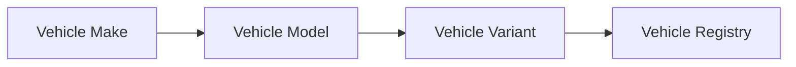
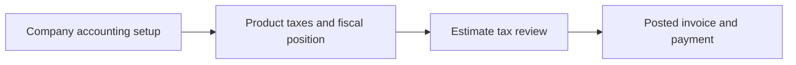
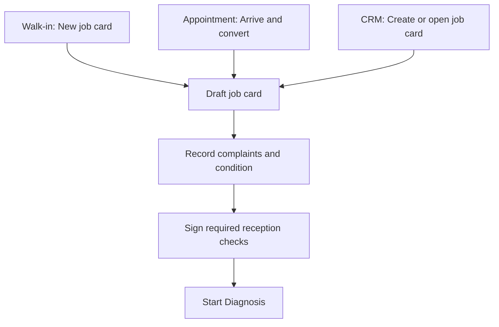
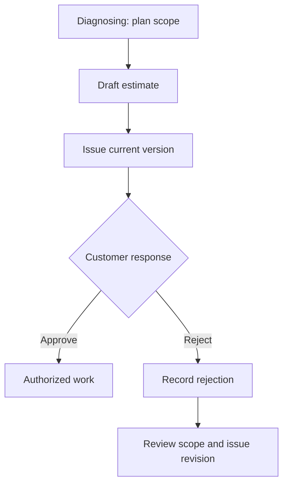
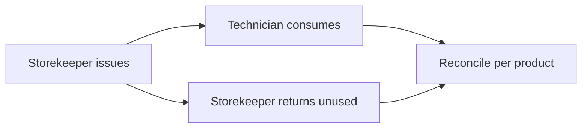
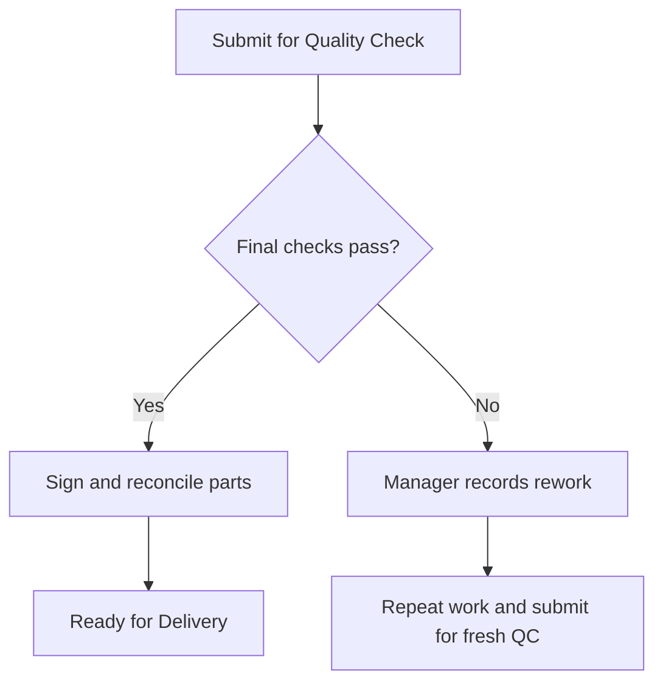
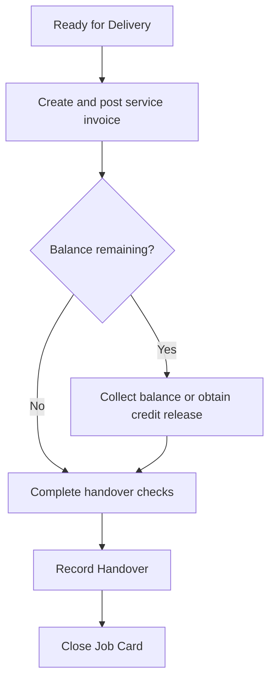

# Garage Suite Basic
**User Manual and Business Workflows**

Odoo 19 · Configuration, daily operations, and reporting

For workshop managers, receptionists, service advisors, technicians, quality inspectors, parts staff, cashiers, and owners.

## Contents

1. [Set up the company, users, and policies](#01-set-up-the-company-users-and-policies)
2. [Configure vehicle and service masters](#02-configure-vehicle-and-service-masters)
3. [Configure inspection and billing controls](#03-configure-inspection-and-billing-controls)
4. [Navigate Garage Suite Basic](#04-navigate-garage-suite-basic)
5. [Register customers and vehicles](#05-register-customers-and-vehicles)
6. [Receive vehicles and create job cards](#06-receive-vehicles-and-create-job-cards)
7. [Diagnose, estimate, and record consent](#07-diagnose-estimate-and-record-consent)
8. [Execute work and reconcile parts](#08-execute-work-and-reconcile-parts)
9. [Manage holds, rework, and quality](#09-manage-holds-rework-and-quality)
10. [Invoice, collect, and release the vehicle](#10-invoice-collect-and-release-the-vehicle)
11. [Close the visit and follow up](#11-close-the-visit-and-follow-up)
12. [Use the role dashboards](#12-use-the-role-dashboards)
13. [Run operational and customer reports](#13-run-operational-and-customer-reports)
14. [Run financial reports and export results](#14-run-financial-reports-and-export-results)
15. [Resolve common issues and test the workflow](#15-resolve-common-issues-and-test-the-workflow)

## 01. Set up the company, users, and policies

The company controls which records users can see and which currency, accounting setup, and workshop policies apply. Set up each operating company before creating live jobs.

1. In **Settings**, confirm the company name, address, country, and currency. When operating several companies, select the intended company in the company switcher before maintaining masters or posting transactions.
2. Open **Garage Suite Basic › Configuration › Staff and Roles**, or use **Settings › Users**. Give each employee access to the relevant companies and assign their Garage role. The Garage Configuration menu requires a Garage Manager. Staff and policy screens also require system administration access.
3. Set the employee’s timezone so appointment times, report dates, and local-day dashboard metrics align with their working day. Assign skills where relevant. Set technician hourly costs for managers to use in labour costing.
4. Open **Configuration › Garage Policies**. Set **Estimate Validity (days)**, **Maximum Advisor Discount (%)**, and **Expiry Reminder Lead Time (days)**. Repeat for each operating company.
5. Confirm that a reception user, assigned technician, independent inspector, and cashier can open the required company and their work queues. Verify their permissions with individual accounts.

| Role | Primary responsibilities |
| --- | --- |
| Workshop Reader | Read permitted workshop records and operational reports. |
| Receptionist | Maintain customer and vehicle intake, book appointments, and receive vehicles. |
| Service Advisor | Diagnose, scope and issue estimates, record consent, assign work, and coordinate handover and closure. |
| Technician | Sign assigned technical checks, log own labour, consume authorized parts, and submit completed work. |
| Quality Inspector | Sign final quality checks and mark vehicles ready. Use someone outside the job’s assigned technician team. |
| Parts Storekeeper | Issue approved parts and record unused returns. |
| Service Cashier | Create, post, and settle service invoices using permitted accounting workflows. |
| Garage Manager | Maintain masters, handle overrides, authorize credit release, and manage exceptions. Inherits operational roles. |
| Garage Owner / Reporting | Review management and billing dashboards and authorized financial reports. |
| System Administrator | Manage technical access and settings. Assign a Garage role separately when operational access is needed. |

Sales and Accounting permissions still apply to their own records. Menu access never overrides company restrictions or job assignments.

## 02. Configure vehicle and service masters

Use **Garage Suite Basic › Configuration**. Create parent masters first so staff can choose valid combinations during intake and quoting.

### Vehicle Masters

1. Open **Vehicle Make** and create manufacturers you service.
2. Open **Vehicle Model** and choose the correct make for each model.
3. Open **Vehicle Variant** and choose its parent model. Create each trim or variant used by your workshop.
4. Create **Vehicle Category** entries for useful groupings. Select the appropriate company on masters intended for a specific business.

### Service Masters

| Menu | What to configure |
| --- | --- |
| Service Category | Group work, such as Maintenance, Brakes, or Electrical. |
| Service Type | Classify visits and CRM enquiries by work type. |
| Service Bay | Create identifiable bays for booking and workshop assignments. |
| Technician Skill | Create skills and assign them to technicians and relevant operations. |
| Service Products and Parts | Create a service product for each billable operation or package. Create goods or consumables for parts and mark eligible garage parts. Check sales price, cost, taxes, and units of measure. |
| Service Operation | Link the service product, category, skills, standard hours, and fixed or hourly pricing method. |
| Labour Rate | Set the operation rate in company currency. Add make- or model-specific rates where needed. |
| Service Package | Link a service product and the operations included in its price. |
| Waiting Reasons | Create reasons and classify each as waiting for parts, approval, or other. |

When entered through the form, an operation fills its name, service product, hours, and labour charge. Model-specific rates take precedence over make-specific rates, followed by the generic operation rate. The service product price is the fallback. Hourly rates multiply by planned hours. Mark package operations as included only when they belong to the selected package, so the estimate does not charge them separately.

## 03. Configure inspection and billing controls

### Inspection templates

1. Open **Configuration › Service Masters › Inspection Template** and create templates for **Reception**, **Technical**, **Final Quality**, and **Delivery**.
2. Add one line per check. For example, use visible damage and accessories for Reception, scope and safety checks for Technical, completed repair and functional checks for Final Quality, and documents and keys for Delivery.
3. Mark required checks as mandatory. A mandatory line must pass before sign-off. Every line must have a recorded result.
4. Select **Default for Jobs** when that template should be selected automatically. On the job, confirm the template list and use **Generate Inspections** to create its checklists.
5. Test final and delivery sign-offs before go-live. These phases require signed evidence even if no default template has been configured.

### Billing and localization

1. In standard **Accounting** settings, confirm the company’s chart of accounts, fiscal country, currency, registration details, and payment methods.
2. Open **Configuration › Billing Configuration** to review **Taxes**, **Journals**, and **Fiscal Positions**. The menu requires the corresponding Accounting Manager access as well as access to Garage Configuration.
3. Confirm taxes on service and parts products, fiscal-position mapping for representative customers, the sales journal, and permitted payment journals and methods.
4. With the optional Bahrain, Saudi Arabia, UAE, or India tax addon installed, use the corresponding country tax list under **Billing Configuration**. These lists use Odoo’s native accounting setup.
5. Run a sample estimate through invoice posting, partial payment, settlement, and receipt printing. Have the accounting team verify the invoice and tax treatment for the company.

## 04. Navigate Garage Suite Basic

Open **Garage Suite Basic** from the app launcher. **Overview** is the workspace dashboard and opens by default for users with Garage access. The company switcher controls the records available to the user. The following menu paths are relative to Garage Suite Basic.

| Menu path | Use it to |
| --- | --- |
| Overview | Select a role workspace, open priority queues, and review recent job cards. |
| Customers & Vehicles › Customer Directory | Find and maintain workshop customer profiles and their service history. |
| Customers & Vehicles › Vehicle Registry | Find vehicles by registration or VIN, view visits, and review identity and ownership history. |
| Front Desk › CRM Enquiries | Track workshop opportunities and create or open a linked job card. |
| Front Desk › Appointments › Calendar / Appointment Register | View bookings by day, create appointments, and record arrival or no-show. |
| Front Desk › Follow-ups › Service Reminder | Review due service and document follow-ups and capture feedback. |
| Workshop › Job Cards | Create or open a visit and see its stage, work, inspection, estimate, and delivery records. |
| Workshop › My Assigned Jobs / Quality Check Queue / Ready for Delivery | Open the corresponding work list when your role grants access. |
| Workshop › Inspections / Technician Time / Parts Movements | Work directly from the inspection, time, and parts registers. |
| Commercial › Estimates › Estimate Versions | Find Garage estimates and see revisions and customer consent. |
| Commercial › Service Billing › Invoices and Credit Notes / Payments and Receipts | Open Garage-linked financial documents. Create the service invoice from the job card. |
| Reports › Workshop / Labour & Parts / Customers & Vehicles / Billing & Margin | Open the register, graph, or pivot for a reporting question. |
| Reports › Export PDF or Excel | Download rows for a selected report and date range. |
| Configuration | Maintain masters, staff, garage policies, and billing configuration. |

**Job card anatomy.** The top tiles show visit status, planned and logged labour, and expected delivery when entered. Use the header buttons to advance the visit. The tabs keep reception, planned labour, inspections, estimates, actual labour and parts, delivery, and billing information on the same job.

## 05. Register customers and vehicles

**Purpose.** Link every visit to the correct customer and identifiable vehicle. Correct identity or ownership on the existing vehicle so its service history stays attached.

### Customer registration · Receptionist or advisor

1. Open **Customers & Vehicles › Customer Directory**. Search by name, phone, email, tax ID, registration, or VIN before creating a record.
2. Select **New** only when the customer does not already exist. Choose individual or company and enter the name, reliable contact details, and billing address.
3. Confirm **Garage Customer** on the profile. For a fleet, use the company and its relevant contacts. Record tax details only when applicable.
4. In the Garage details, record the preferred contact channel and explicit service reminder consent. Record marketing consent separately if applicable.
5. Save and review the customer’s Garage tab for linked vehicles and visits. Estimate and invoice history depend on the user’s roles.

### Vehicle registration · Receptionist or advisor

1. Open **Customers & Vehicles › Vehicle Registry** and search both the registration number and VIN/chassis number.
2. Select **New** and choose the current customer. Enter registration and VIN/chassis in their separate fields. At least one is required. Normalized duplicates are blocked within the company.
3. Choose the make, model, variant where applicable, and vehicle category. In **Specifications**, enter relevant year, fuel, transmission, insurance and pollution-certificate expiry, and next-service interval in months or kilometres.
4. Save. Capture the actual odometer on every visit. The registry derives the latest odometer from visits.
5. For an ownership transfer or identity correction, have a Garage Manager update the existing vehicle and enter a change reason. Review **Identity and Ownership History** for the audit entry. Prior job cards retain their reception identity and customer.

## 06. Receive vehicles and create job cards

Each intake route creates a Draft job card with a customer, vehicle, and reception context. Enter the customer’s reported symptoms before diagnosis.

| Route | Step-by-step |
| --- | --- |
| Walk-in | Open **Workshop › Job Cards › New**. Select the current customer and vehicle. Record the reception date, odometer, advisor, and expected delivery if agreed. Save. |
| Appointment | Open **Front Desk › Appointments**. Enter customer, vehicle, bay, start, end, complaint, and odometer. Save as Booked. On arrival select **Mark Arrived**, then **Open Job Card**. Repeating conversion opens the existing job. |
| CRM enquiry | Open **Front Desk › CRM Enquiries › New**. Enter the enquiry and customer, then link the customer’s vehicle and service type in the Garage tab. Save and use **Create / Open Job Card**. Reopening uses the existing linked job. |

1. On a booking, check the Calendar for the bay and time. Overlapping booked or arrived appointments for the same bay are blocked. To reschedule, save the new times with a change reason. For cancellation or a missed appointment, set **Cancelled** or **No-show** and record why.
2. On the Draft job, check the vehicle, current customer, and odometer. A lower reading needs a Garage Manager and an exception reason. For a repeat repair, reference the earlier job for that vehicle.
3. Record the complaint, visible condition, accessories, and fuel level where relevant. Select the applicable inspection templates, generate checklists, and sign required Reception checks.
4. The advisor selects **Start Diagnosis**. The vehicle, customer, and reception odometer are locked once the job leaves Draft.

## 07. Diagnose, estimate, and record consent

**Purpose.** Authorize a precise scope and preserve the customer’s response against the issued version.

1. Open the job’s **Reception and Diagnosis** tab. Record findings separately from the original complaint. Set the expected delivery and assign technicians and a bay as appropriate.
2. In **Planned Labour**, add catalogue operations or a selected package. Check billable service products, hours, pricing, and package inclusions.
3. Click **Prepare Estimate / Revision**. Review labour and package lines. Add the parts products and maximum authorized quantities. Check rates, discounts, taxes, and the validity date.
4. Select **Issue Service Estimate**. Use a Garage Manager when a line discount exceeds the advisor limit. The first issue moves a Diagnosing job to **Awaiting Approval**.
5. Capture the approver, channel, and evidence under **Garage Consent**. The approver must be the customer or an authorized linked contact. Use **Record Customer Approval** or **Record Rejection** while the current estimate is valid. Approval confirms the Sales estimate and authorizes the awaiting job.
6. For a new scope, create another version using **Prepare Estimate / Revision**. If the latest version is Draft or Issued, the button reopens that version. A new revision carries forward scope from the prior version. Verify quantities for parts already issued or consumed. Obtain fresh consent before working to the revised scope.

An expired estimate cannot accept approval or rejection. **Prepare Estimate / Revision** may reopen the expired Issued version, so escalate to the manager for a documented resolution before work begins. Keep the customer’s evidence with the version it covers.

## 08. Execute work and reconcile parts

**Purpose.** Track what the technician actually did and which approved parts were installed.

### Start and log labour · Assigned technician

1. Open **Workshop › My Assigned Jobs** and select the **Authorized** job.
2. Complete and sign required Technical inspections. Select **Start Work** after required checks and assignment are in place.
3. In **Labour and Parts**, add a time entry with the job, planned operation, assigned technician, and start. Leave the end blank to run a timer, then use **Stop Timer** from the time entry. For elapsed work, record both timestamps.
4. Record time after reception and current approval, within the approved scope. Do not overlap entries for the same technician or enter future time. Completed entries are retained as evidence; report errors to the manager.
5. Log completed time against every operation with positive planned hours. Stop all timers before submitting to Quality.

### Record parts · Storekeeper and technician

1. In **Workshop › Parts Movements**, or from the job’s **Labour and Parts** tab, create an **Issue** for the approved product. Enter the quantity and reason. The storekeeper performs this step.
2. The assigned technician records **Consume** for the installed or used quantity. The storekeeper records **Return** for unused material. Use the product’s base unit of measure.
3. Reconcile each product before readiness. If two filters were issued, one consumed and one returned, the recorded total balances and the invoice bills one filter.
4. Compare the movement register to the estimate and alert the advisor before working outside approved quantities. These movements are workshop evidence. Warehouse stock is managed separately.

## 09. Manage holds, rework, and quality

### On hold and rework

1. On an **In Progress** job, record the waiting reason, description, and responsible person on **Hold and Delivery**. Select **Put On Hold**.
2. Resolve the underlying problem. For revised scope, prepare the revision and record fresh customer consent before resuming the work. Enter the **Hold Resolution** and select **Resume Work**.
3. If a job in Quality Check, Ready, or Closed needs rework, have the manager enter the exception reason and use **Rework / Reopen**. Verify any posted accounting documents and agree on the correction path before restarting billing-related work.
4. Generate inspections for the new work revision. Keep earlier inspection records as history. Complete the revised work and obtain new final and delivery evidence for the current revision.
5. For an early visit that will not proceed, the manager records a cancellation reason and uses **Cancel Visit** when available. Jobs with posted activity, recorded time, or parts require review. Preserve the original records.

### Final quality · Technician and independent inspector

1. The technician stops all timers, confirms that required labour entries are complete, checks **Work Complete**, and clicks **Submit for Quality Check**.
2. The inspector opens **Workshop › Quality Check Queue** and selects the current Final inspection. Record checks, remarks, and any relevant photos. Every mandatory check must pass before **Sign Inspection**.
3. If a mandatory item fails, record it and send the job for manager-controlled rework. An assigned technician cannot sign the job’s Final inspection.
4. After the current Final inspection is signed, confirm issued quantities equal consumed plus returned quantities per product. Select **Mark Ready for Delivery**.

## 10. Invoice, collect, and release the vehicle

**Purpose.** Bill approved completed work and retain settlement and handover evidence.

1. **Cashier:** On the Ready job card, select **Create / Open Invoice**. Garage reuses the service invoice when one already exists. Review the linked estimate, customer, journal, taxes, labour and package amounts, and consumed parts. Parts are billed from consumption, up to approved quantities.
2. **Cashier:** Post the checked invoice. Use the standard payment action from that invoice. Choose the journal, inbound payment method, date, and amount. Repeat for split or partial payments and check the remaining amount after each entry.
3. **Cashier or manager:** Review the posted balance. Settlement allows handover once the other conditions are met. If a balance remains under agreed credit terms, the manager records a **Credit Release Reason** and selects **Authorize Credit Release**. This records the exception without clearing the balance.
4. **Advisor:** Complete the Delivery inspection and select **Sign Inspection**. In **Hold and Delivery**, record the delivery recipient and acknowledgment. Capture the signature if required by your workshop.
5. **Advisor:** Select **Record Handover**. If it is blocked, check the posted invoice, residual balance or recorded credit release, signed Delivery inspection, and handover fields.
6. **Manager:** For a supported billing correction, record the **Garage Correction Reason** on the service invoice and use the standard credit note action. Verify the link to the original invoice, company currency, and correction amount. Post with the required rights and handle any refund or reconciliation through Accounting.

## 11. Close the visit and follow up

1. After handover, the advisor opens the Delivered job card and selects **Close Job Card**. Closure records the completion time.
2. When the current owner matches the job customer and the vehicle has a service interval in months, closure creates a next-service reminder. If an interval in kilometres is configured, the reminder shows the target odometer based on the visit reading.
3. Open **Front Desk › Follow-ups › Service Reminder**. Check the due date, reminder type, assigned user, channel, and contact permission. Insurance and pollution-certificate reminders depend on the vehicle dates and the configured lead time.
4. Verify that the recipient is still the current owner and has service contact consent. Contact them using the recorded channel, then record feedback and satisfaction when available. Select **Mark Followed Up**.
5. If consent is absent or ownership changed, review the record and add internal notes. Use your workshop’s approved communications process. Basic creates reminders and internal activities; external messages are handled separately.

**End-to-end job stages.** Draft → Diagnosing → Awaiting Approval → Authorized → In Progress → Quality Check → Ready → Delivered → Closed. Holds, rework, and early cancellation follow the controls listed in chapter 09.

## 12. Use the role dashboards

Open **Overview** and select a workspace tab. You can see multiple tabs when you hold multiple roles. Click a KPI card, pipeline bar, day bar, or recent job to open matching records. Use **New job card** when present or **Export reports** to open the report wizard.

| Workspace | KPI cards | What to do next |
| --- | --- | --- |
| Front Desk | Received today, ready for delivery, overdue delivery, upcoming appointments, arrived bookings without a job. | Process arrivals, open job cards, and flag overdue handovers. |
| Service Desk | Awaiting approval, ready for delivery, overdue delivery, your open visits, your due follow-ups. | Chase consent, coordinate delivery, and review your assigned follow-ups. |
| My Work | Your authorized, running, and held visits, running timers, hours logged. | Open your assigned work and stop timers when work ends. |
| Quality | Ready for delivery, repeat or rework visits, awaiting quality check, draft Final inspections with failed items. | Review failed checks and sign eligible final inspections. |
| Parts Desk | Parts holds, issue entries, consumption entries, and return entries. | Resolve shortages and reconcile parts per job. Movement tiles count entries. Use the register for quantities. |
| Billing | Draft service invoices, posted invoices with a balance, today’s revenue and collections, current outstanding amount. | Post drafts, collect balances, and verify payment status. |
| Management | Active jobs, overdue delivery, readiness, approvals, parts holds, repeat or rework, completed visits, labour hours, and permitted financial totals. | Review bottlenecks and staffing before opening the corresponding queues. |
| Workshop | Open and overdue jobs, readiness, registered vehicles, and customers. | Review permitted records without an operational role assignment. |

**How the dates work.** The 7-, 30-, 90-day, and All time filters affect selected-period measures, the visit pipeline, and recent job cards. Live queues keep their own criteria. The vehicle receipt chart always shows the last seven local calendar days. Daily revenue and collections use the current company and local date. Outstanding amounts reflect currently posted balances. User access and active companies can change what appears.

## 13. Run operational and customer reports

From **Reports**, open the matching submenu. Use the search bar to set dates, filters, and groupings available to that view. Where a pivot or graph is offered, group by a dimension such as stage, technician, customer, or period, then open the underlying records to validate a total.

| Reports submenu | Report | What it answers / export date |
| --- | --- | --- |
| Workshop | Workshop Performance | How many visits were received, by stage or advisor? Compare estimated and actual hours. Uses job reception date. |
| Workshop | Appointments and No-shows | Which bookings arrived, converted, cancelled, or missed their slot? Uses booking start. |
| Workshop | Pending Delivery | Which jobs are currently Ready? Uses expected delivery date. |
| Workshop | Estimate Pipeline | Which estimate versions are draft, issued, approved, or rejected? Uses estimate date. Available to advisors, cashiers, and owners with Sales access. |
| Workshop | Inspection Register | Which inspections exist and who signed them? Uses inspection creation date, with sign-off time in the export. |
| Labour & Parts | Planned Labour | Which operations were planned and at what charge and hours? Uses the parent job’s reception date. |
| Labour & Parts | Technician Time | Who logged which time and on which job? Uses time-entry start. |
| Labour & Parts | Parts Issues Consumption and Returns | What was issued, consumed, or returned? Compare quantities within each product and unit. Uses movement time. |
| Customers & Vehicles | Customer Service History | Which visits belong to a customer? Uses job reception date. |
| Customers & Vehicles | Vehicle Service History | What work has this vehicle returned for? Uses job reception date. |
| Customers & Vehicles | Customer Service Frequency | How frequently do customers return for completed visits? Uses reception date on Closed jobs and includes the close time. The export preset is **Completed Customer Service Frequency**. |
| Customers & Vehicles | Service Follow-ups and Feedback | What reminders are due or complete and what satisfaction was recorded? Uses reminder due date. |

**Printed operational documents.** Open an individual job card or inspection and use **Print › Job Card** or **Print › Inspection Report** where your access allows. These produce the record document. Use the export wizard for a register spanning multiple records.

## 14. Run financial reports and export results

### Billing & Margin reports

For individual documents, use **Commercial › Service Billing › Invoices and Credit Notes** or **Payments and Receipts**. Payment status follows Odoo’s payment and journal reconciliation process.

| Report | What it answers / export date |
| --- | --- |
| Service Revenue and Outstanding | Which Garage invoices and credit notes are posted, and what balance remains? Uses invoice date. |
| Daily Customer Collections | Which eligible customer payments were recorded by date and journal? Uses payment date. |
| Outstanding Service Invoices | Which posted invoices still have a residual balance? Uses invoice date and includes the due date. |
| Labour and Parts Revenue | Which posted lines generated revenue by labour, parts, or package? Uses the accounting line date. |
| Service Revenue, Cost and Margin | What is the operational margin on ready, delivered, or closed visits? Uses reception date. Costs come from recorded labour and consumed parts. Available to managers and owners. |

The financial invoice, collection, outstanding, and revenue registers require cashier or owner access and applicable Accounting permissions. Review one company at a time for comparisons involving amounts.

### PDF or Excel · Any permitted report

1. Open **Reports › Export PDF or Excel**, or choose **Export reports** on Overview.
2. Select the report. Set **From** and **Through** for the relevant date field. Both dates include the selected local calendar day. Blank boundaries are unrestricted by the wizard.
3. Choose **Download PDF** for a printable register or **Download Excel** for a worksheet with filters. Each export applies the selected report’s saved criteria, date range, and your record access. Filters and pivot groupings on a previously opened screen are separate.
4. If the range is too large, narrow it or export in batches. The PDF limit is 500 rows, and the Excel limit is 20,000 rows.
5. Check the company, date range, and report name before comparing totals. For example, use **Daily Customer Collections** for payment activity and **Outstanding Service Invoices** for open balances. A payment can occur in a different period from its invoice.

## 15. Resolve common issues and test the workflow

| Symptom | Check and resolve |
| --- | --- |
| Menu or button missing | Confirm the selected company, assigned role, native Sales or Accounting permissions, and the record’s current stage. |
| Duplicate vehicle or lower odometer error | Search both identifiers before creating a vehicle. Verify the reading and use the manager’s exception reason only for a genuine lower reading. |
| Cannot start work | Confirm the current estimate is approved, a technician is assigned, and required Technical inspections have passed. |
| Cannot submit to Quality | Stop every timer, log a completed entry for each operation with planned time, and set **Work Complete**. |
| Cannot mark Ready | Check the current Final inspection is signed by an eligible inspector and reconcile issue, consumption, and return for each part. |
| Cannot record handover | Verify the invoice is posted, the balance is settled or credit release is recorded, and current Delivery evidence and recipient details are present. |
| Report blank or unexpectedly low | Check the company, report date field, date range, role permissions, and applicable workflow stages. |
| Demo pack installed but records are missing | Grant your user access to the corresponding **Garage Demo** company and select it in the company switcher. |

### Practice in a training database

Install a country demo pack for Bahrain, Saudi Arabia, UAE, or India and switch into its dedicated **Garage Demo** company. The pack seeds synthetic records over 13 completed months plus recent activity. Use a broad date range for history reports.

1. Book a vehicle, mark it arrived, and open its Draft job.
2. Complete reception, add an operation and part, and issue an estimate.
3. Record approval, assign a technician, log time, and reconcile an issue with consumption and return.
4. Switch to an eligible inspector for Final QC. Mark the job Ready.
5. Post an invoice, apply a partial payment, and confirm a balance remains. Settle it or record a manager credit release in the training company.
6. Sign Delivery, record handover, close the job, and locate its follow-up reminder.
7. Export Workshop Performance and Outstanding Service Invoices. Compare the new records against the role dashboards and registers.

This manual follows the current Garage Suite Basic menus, workflow actions, and report presets in the Odoo 19 addon.
